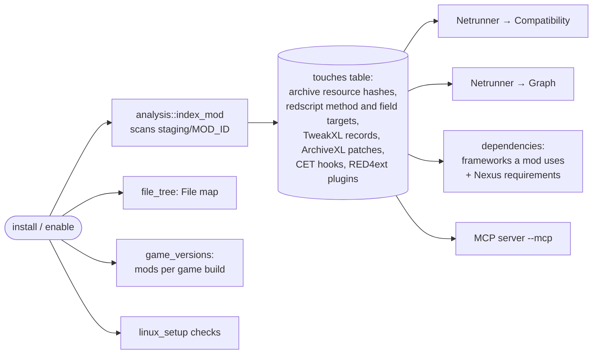

# After install

Back to [[Home]] · previous: [[Disable, enable, uninstall, verify]].

What a successful install feeds, and what the game itself still has to do.

## Game-side steps the app does not run

The app only copies files. These happen when the game starts, and are where a
correctly installed mod can still "not work":

| Mod type | Needs at game start | App's part |
|---|---|---|
| REDmod (`mods/…`) | launch option `-modded`, then the game's REDmod deploy writes `r6/cache/modded` | `linux_setup` adds `-modded` to the Steam launch options when REDmods are present |
| CET mods | CET's `version.dll` loaded, VC++ runtime in the prefix | `linux_setup` checks the `version` DLL override and the VC++ runtime DLLs in the prefix |
| RED4ext plugins | `winmm.dll` loaded | `linux_setup` checks `winmm` DLL override |
| redscript (`r6/scripts`) | redscript compiles on start; errors in `r6/logs/redscript_rCURRENT.log` | Netrunner → Crashes & logs, startup timeline |
| TweakXL / ArchiveXL | frameworks installed | dependency check, Compatibility "missing framework" |
| ReShade | DLL override for `dxgi`/`d3d11` etc. | ReShade card adds it to the launch-options line |

When a mod installs but doesn't load, check the startup timeline and logs in
Netrunner before suspecting the layout. When it installs to the wrong place,
see [[Known gaps]].
