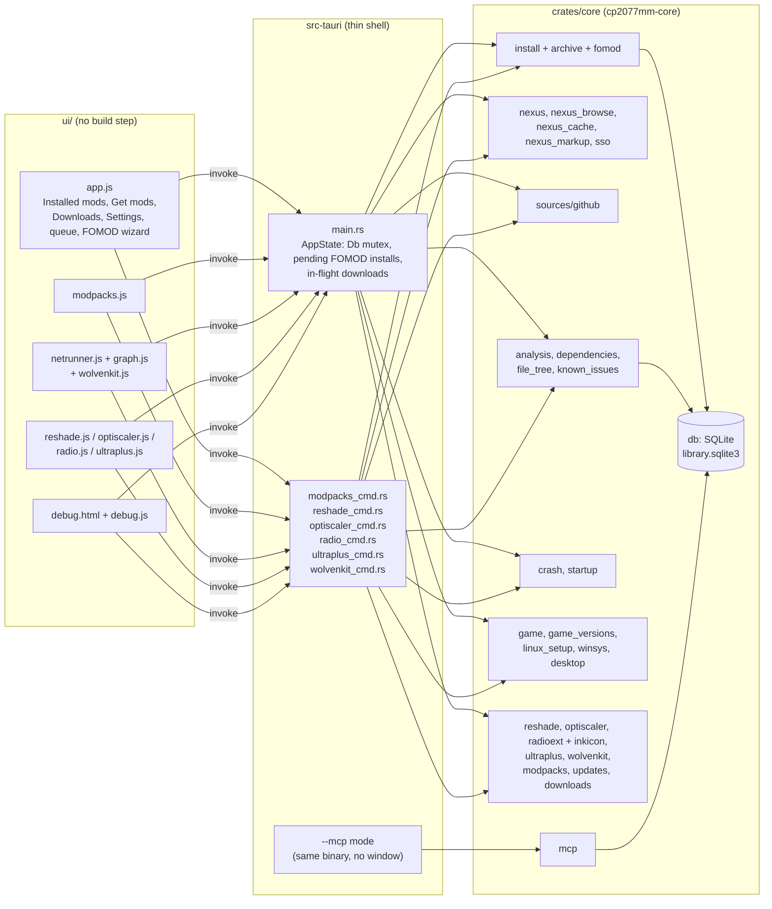
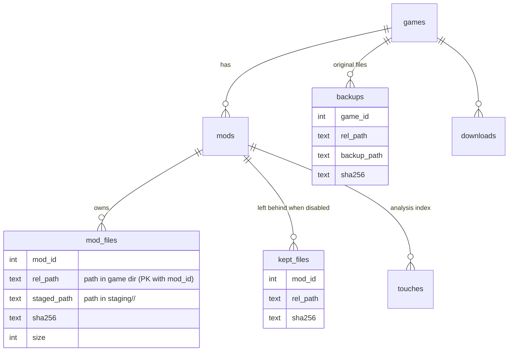

# App structure

Back to [[Home]].

Three layers. All logic lives in `crates/core` so it runs headless in tests;
`src-tauri` only wires commands to it; `ui/` is plain HTML/JS calling those
commands with `invoke(...)`.

## Tabs and what they call

| Tab (button label) | UI file | Main commands | Core modules |
|---|---|---|---|
| Installed mods | `app.js`, `profiles.js`, `reshade.js`, `optiscaler.js`, `radio.js`, `ultraplus.js` | `install_archive`, `finish_install`, `uninstall_mod`, `disable_mod`, `enable_mod`, `verify_mod`, `untracked_mods`, `adopt_mods`, `open_stored_copy`, `stored_copies_dir`, `check_updates`, `game_version_history`, `*_profile(s)`, `reshade_*`, `optiscaler_*`, `fsr4_overrides*`, `radio_*`, `ultraplus_*` | `install`, `untracked`, `updates`, `game_versions`, `profiles`, `reshade`, `optiscaler`, `radioext`, `ultraplus` |
| Modpacks | `modpacks.js` | `nexus_collections`, `collection_view`, `track_collection`, tags, `export_modlist`, `import_modlist`, `mod_dependencies` | `modpacks`, `nexus_browse`, `dependencies` |
| Netrunner | `netrunner.js`, `graph.js`, `wolvenkit.js` | `analyze_game`, `mod_file_tree`, `load_order_view`, `set_load_order`, `reset_load_order`, `crash_analysis`, `read_log`, `wolvenkit_*` | `analysis`, `file_tree`, `load_order`, `crash`, `startup`, `known_issues`, `wolvenkit` |
| Get mods | `app.js` | `nexus_search`, `nexus_mod_details`, `nexus_download`, `nexus_open_in_app`, `source_search`, `source_download`, `framework_plan` | `nexus`, `nexus_browse`, `sources::github` |
| Downloads | `app.js` | `list_downloads`, `install_download`, `delete_download`, `organize_downloads` | `downloads`, `install` |
| Settings | `app.js` | `nexus_set_key`, `nexus_sso_login`, `set_downloads_location`, `register_nxm_handler` | `secrets`, `sso`, `desktop`, `downloads` |
| Game panel | `app.js` | `detect_games`, `add_game_path`, `setup_checks`, `setup_fix`, `setup_undo` | `game`, `linux_setup`, `winsys` |
| Terminal | `debug.js` | `activity_log`, `nexus_requests` | `activity`, `nexus_cache` |

The install-related commands are traced in [[Entry points]].

## Where state lives

All paths come from `core::paths` (XDG on Linux, `dirs` equivalents on Windows).

| What | Where | Written by |
|---|---|---|
| Library database | `<data>/cp2077-modmanager/library.sqlite3` | `core::db` |
| Unpacked copy of each mod | `<data>/…/staging/<mod id>/` | [[Deploy and tracking]] |
| Archives being installed | `<data>/…/staging/incoming-*/` | [[Archive extraction]] |
| Original game files a mod replaced | `<data>/…/backups/<game id>/<path>` | [[Deploy and tracking]] |
| Archive load order set in Netrunner | `<game>/archive/pc/mod/modlist.txt` (its text also in the `settings` table, to tell it apart from a user's own); a `modlist.txt` that was there before: `<data>/…/backups/modlist-<game id>.txt` | `core::load_order` |
| Downloads | Settings → download location (default `<data>/…/downloads/`) | `core::downloads` |
| Nexus API key | system keyring | `core::secrets` |
| Nexus page cache | `<cache>/cp2077-modmanager/nexus/` | `core::nexus_cache` |

## Database tables that matter for installs

Schema rules: `CREATE TABLE IF NOT EXISTS` in `db::SCHEMA`, new columns in
`MIGRATIONS`, bigger reshapes by hand in `Db::init`. Old user databases must
keep opening.
