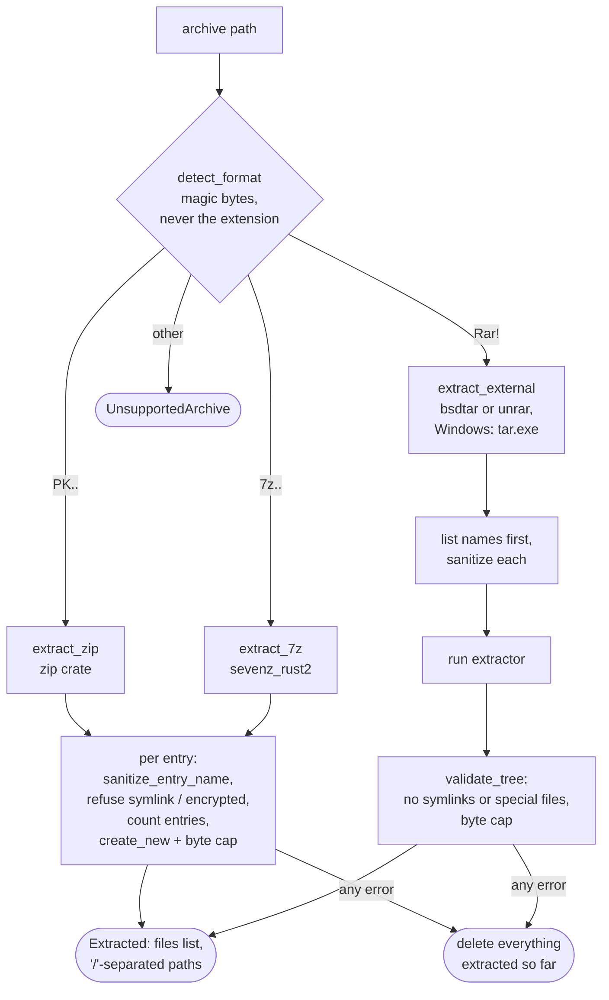

# Archive extraction

Back to [[Home]] · previous: [[Entry points]] · next: [[FOMOD]].

Code: `crates/core/src/archive.rs`, called from `Installer::prepare`.

## Rules

- `sanitize_entry_name`: backslashes become `/`; absolute paths, `..`,
  `:` (drive letters, NTFS streams) and NUL bytes are refused.
- `Limits::default()`: 100 000 entries, 32 GiB of real bytes written (header
  sizes are not trusted).
- `create_new` refuses duplicate entry names and pre-existing symlinks;
  `ensure_inside` re-checks the parent after `create_dir_all`.
- Extraction goes to `staging/incoming-<random>/files`. The folder is deleted
  on error, on **Cancel** in the wizard (`discard`), and at startup
  (`cleanup_incoming`).
- Install tokens are only accepted if they start with `incoming-` and contain
  no `/` or `..` (`prepared_dir`).

The resulting file list is what [[FOMOD]] and [[Layout detection]] work on.

Gap: see "RAR on Windows" in [[Known gaps]].
