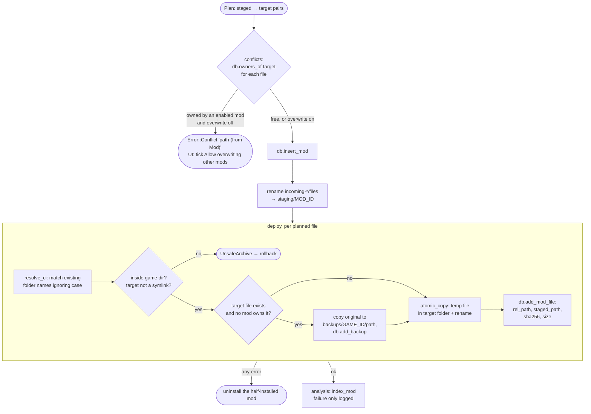

# Deploy and tracking

Back to [[Home]] · previous: [[Layout detection]] · next: [[Versions and replacing]].

Code: `Installer::conflicts`, `Installer::finish`, `Installer::deploy`,
`resolve_ci`, `atomic_copy` in `crates/core/src/install.rs`.

## Ownership rules

- A path's owners are the **enabled** mods with a `mod_files` row for it
  (`owners_of` matches `lower(rel_path)`). Disabled mods don't block.
- With **Allow overwriting other mods** ticked, the new mod's copy goes on top.
  The overridden mod keeps its `mod_files` row, so when the new mod is removed
  the previous owner's staged copy is put back ([[Disable, enable, uninstall, verify]]).
- Only a file **no mod owns** is backed up: that is treated as an original
  game file (or something installed by hand). One backup per game + path.
- `mod_files` has primary key `(mod_id, rel_path)` and is written with
  `INSERT OR REPLACE`: two staged files mapped to the same target inside one
  mod silently become one (see [[Known gaps]]).

## What is kept where

| Thing | Location | Used by |
|---|---|---|
| Unpacked mod | `staging/MOD_ID/` (staged paths as in the archive) | enable, restoring an overridden file, analysis index, File map |
| Original game file | `backups/GAME_ID/<target>` | uninstall / disable |
| Archive hashes | `mods.archive_sha256`, `archive_md5` | update checks, MCP |
| Game build at install | `mods` row (via `game_versions`) | game version ribbon |

## Not tracked

Files the game or a framework writes later (`r6/cache/modded`, CET
`db.sqlite3` / settings, `user.ini` edits, RED4ext logs) never enter
`mod_files`, so uninstall never removes them. See [[Known gaps]].
