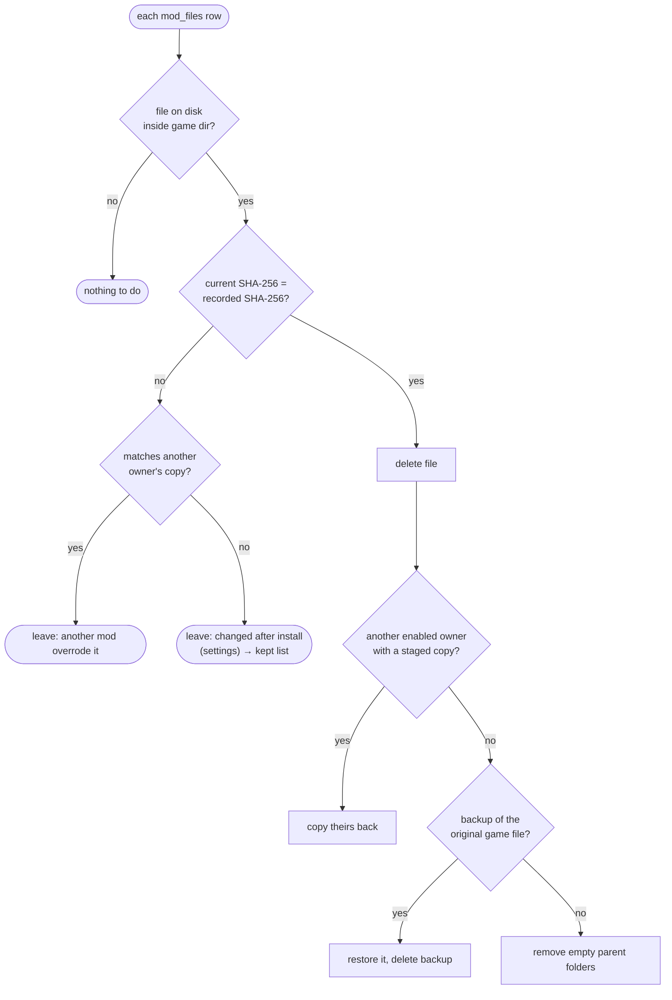

# Disable, enable, uninstall, verify

Back to [[Home]] · previous: [[Versions and replacing]] · next: [[After install]].

Code: `Installer::undeploy`, `disable`, `enable`, `uninstall`, `verify`.
Commands: `disable_mod`, `enable_mod`, `uninstall_mod`, `verify_mod`.

## undeploy (shared by disable and uninstall)

## The four actions

| Action | Effect on game folder | Effect on library |
|---|---|---|
| **Disable** | status set to disabled first (so it no longer owns files), then `undeploy` | staged copy kept; changed files saved in `kept_files` with their hash |
| **Enable** | staged copies re-checked against recorded SHA-256 (refuses if missing/changed: "reinstall the mod"); files still in `kept_files` with an unchanged hash are left alone; conflicts checked as on install; then `deploy` | status enabled, `kept_files` cleared |
| **Uninstall** | `undeploy` if enabled | `mods` row and `staging/MOD_ID` deleted; rows cascade. The `downloads` row and its archive are untouched, so `install_download` reinstalls it |
| **Verify** | read-only | reports ok / missing / modified / overridden per file |

Uninstall leaves files that changed after install in the game folder and
then forgets them, because the mod row is deleted. See [[Known gaps]].

## Adopting untracked mods

`untracked::scan` lists mods in the game folder with no `mod_files` row
(command `untracked_mods`, section *Not installed by CPMX2077* in
`app.js`). Units: each `archive/pc/mod/*.archive` with `<stem>.xl` /
`<name>.archive.xl`, leftover `.xl` files alone, and one per entry under
`mods/`, CET `mods/`, `red4ext/plugins/` (minus ArchiveXL, TweakXL,
Codeware), `r6/scripts/`, `r6/tweaks/`. `.log` and `.disabled` files are
ignored; a folder unit holding any tracked file is skipped (it is a tracked
mod's runtime files). Symlinks are not followed.

`untracked::adopt` (command `adopt_mods`) re-scans, finds the unit by key,
inserts a `mods` row with source `adopted` and `archive_name` = the unit's
path, copies each file to `staging/MOD_ID/<rel_path>`, records its SHA-256
in `mod_files` and dates `installed_at` by the newest file. Nothing is
deployed and no backups are made, since the files are already in place.
From then on Disable / Enable / Uninstall / Verify above apply unchanged.
On failure the row and staging folder are removed.

Unadopted units still feed the analysis: `analysis::untracked_indexes`
scans them in place (archive scans cached by path, size and mtime) and adds
them to `report_for_game` / `report_from_index` with negative ids and the
name suffix *(untracked)*; `file_tree::build` adds their resource touches to
the wins/loses counts.

## Mod profiles

`profiles::apply` (command `apply_profile`, card in `ui/profiles.js`) runs
**Disable** on every enabled mod not in the profile, then **Enable** (no
overwrite) on every disabled mod in it. Failures are collected per mod and
the rest go ahead. Profiles live in `profiles` / `profile_mods`, keyed by
game version string and `modpacks::mod_key` plus archive name.

Modpack installs (`ui/modpacks.js`, **Separate profile** ticked) call
`profiles::switch_to_pack` (command `switch_to_modpack_profile`; dry run
`pack_plan` / `modpack_profile_plan`) before queueing: it saves the enabled
mods as *Before* followed by the collection name when no profile is active, creates or reuses
the profile whose `collection_slug` is the collection, writes the
collection's mods (`nexus:<id>` + file name, merged with what the profile
already lists) plus enabled frameworks (`dependencies::framework_of`), sets
`load_order` to `''` and applies it. Queued mods are `missing` until they
install, then count as part of the profile.
