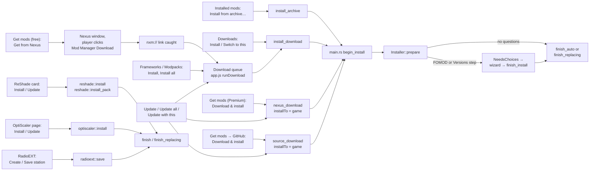

# Entry points

Back to [[Home]] · next: [[Archive extraction]].

Everything a player can click that ends in an install. All of them reach
`Installer::prepare` and then `finish` / `finish_auto` / `finish_replacing`
(see [[Install pipeline]]).

| Entry | Command | Source recorded | Replaces | Notes |
|---|---|---|---|---|
| **Install from archive…** | `install_archive` | `manual` | auto ([[Versions and replacing]]) | Name from FOMOD `moduleName`, else file name |
| Downloads **Install** / **Switch to this** | `install_download` | from the download row (`nexus`, `github`, …) | `replaces` = the other version of the same mod | |
| **Download & install** (Nexus, Premium) | `nexus_download` (`run_download`) | `nexus` + mod/file id | `replaces` from the update check | Already-downloaded files skip the download |
| **Get from Nexus** (free account) | Nexus window → `nxm://` → queue → `nexus_download` → `install_download` | `nexus` | as queued | One click per mod; no automated clicking (product rule) |
| GitHub **Download & install** | `source_download` | `github` + repo | same repo | SHA-256 checked against GitHub's digest |
| Frameworks **Install**, Modpacks **Install all** | `enqueue(...)` → queue | per item | | Queue downloads one at a time, then installs one at a time; a FOMOD pauses the queue for the wizard |
| ReShade card | `reshade_install*`, `reshade_pack_install` | `reshade` / pack repo | previous ReShade / pack | Builds its own staging, skips layout detection and FOMOD |
| OptiScaler page **Install OptiScaler** / **Update to …** | `optiscaler_install` | `optiscaler` + `optiscaler/OptiScaler`; `source_file` = DLL name | previous OptiScaler | Newest stable GitHub release (SHA-256 checked when published). `optiscaler::install` stages the archive with `Installer::prepare`, skips layout detection and FOMOD, and relays it with `optiscaler::layout`: everything beside `OptiScaler.dll` to `bin/x64`, that DLL renamed to the proxy name (`pick_proxy`: `wininet.dll`, then `dxgi.dll`), setup scripts dropped. With the FSR box ticked, `download_amd_dll` fetches AMD's `amd_fidelityfx_upscaler_dx12.dll` 4.1.1.2740 (pinned commit, checked by `check_amd_dll`: git blob id and version resource) and it replaces the archive's copy in staging; `fsr4_ini` then sets the staged `OptiScaler.ini` to FSR 4 (`FSR4_INI`), so the tracked hash is of the edited file. |
| RadioEXT **Create station** / **Save station** | `radio_save` | `radioext` + station folder in `source_ref` | the station's earlier version (same folder) | `radioext::save` stages the station laid out from the game root (game-root layout): the user's song files copied after a content check, kept songs hard-linked from the stored copy, `metadata.json` written. A folder no mod owns is renamed aside while it installs, so its files aren't backed up as game files, then removed (put back on failure). |

## Before an archive reaches the installer

- **Nexus**: `nexus::Client::download` hashes the file and checks its MD5
  against Nexus' `md5_search`. A mismatch or a hash Nexus has no record of
  deletes the file; a lookup that fails keeps it marked *unverified*.
- **GitHub**: SHA-256 compared with the digest GitHub publishes for the asset;
  a mismatch deletes the file.
- Identical bytes already in Downloads are kept once (`keep_one_copy`).

These checks are product requirements (README "Download safety").
