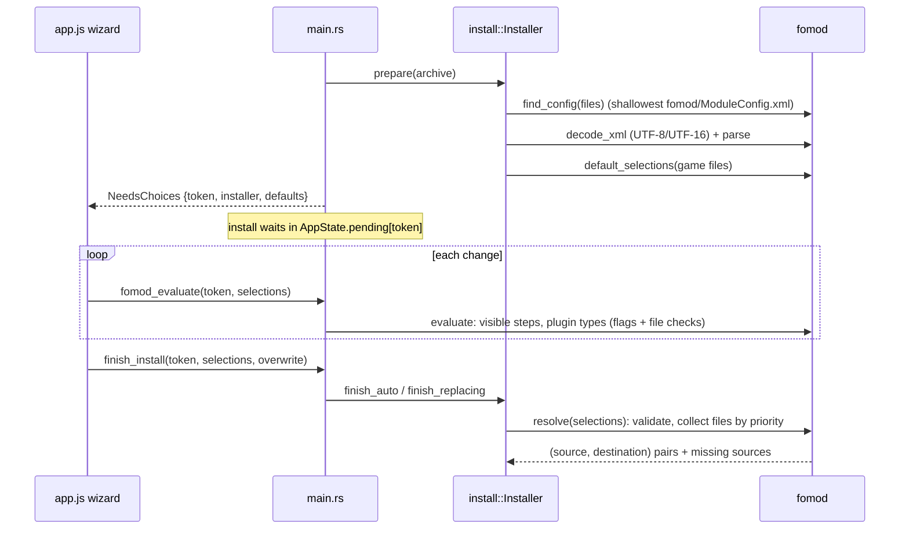

# FOMOD

Back to [[Home]] · previous: [[Archive extraction]] · next: [[Layout detection]].

Code: `crates/core/src/fomod.rs`; wiring in `Installer::prepare`,
`Installer::plan_prepared`, and the commands `fomod_evaluate`, `fomod_image`,
`finish_install`, `cancel_install` in `src-tauri/src/main.rs`. UI wizard:
`runWizard` in `ui/app.js`.

## How choices become files

1. `module_dependencies` false → refused ("requires other mods or files that
   aren't installed").
2. `validate`: each visible group's rule (`SelectExactlyOne`, `AtMostOne`,
   `AtLeastOne`, `All`, `Any`), no *NotUsable* option chosen, every
   *Required* option chosen.
3. Files collected from `requiredInstallFiles`, chosen plugins,
   `alwaysInstall`, `installIfUsable`, and `conditionalFileInstalls` whose
   flag/file conditions match.
4. Sorted by `priority` (document order breaks ties); a later entry for the
   same destination wins. Matching against archive paths ignores case.
5. Destinations go through `sanitize_entry_name` (no `..`, no absolute path).
6. Sources the XML names but the archive lacks are listed as *Skipped
   (named by installer, not in archive)*; if nothing at all resolves, the
   install fails with "the chosen installer options don't install any files".

File conditions (`fileDependency`) check the game folder through
`install::game_files` (case-insensitive exists). States are only *Active* or
*Missing*; *Inactive* is never reported.

A FOMOD's destinations are used as-is: [[Layout detection]] is **not** run on
FOMOD output.

## Versions step

`install::variant_choice` builds a one-step installer when an archive of
**loose** files (layout `loose`) holds two or more groups whose names share a
prefix/suffix of at least 3 characters at a word boundary, e.g.
`Skin_HEAD_PALE_Natural.archive` / `Skin_HEAD_TAN_Natural.archive`. All are
ticked by default (`SelectAtLeastOne`), so installing without answering
changes nothing. `plan_prepared` then runs normal [[Layout detection]] and
drops unticked files as *(not chosen)*. Not offered when one name is empty
(a base file plus a patch) or for any non-loose layout.
