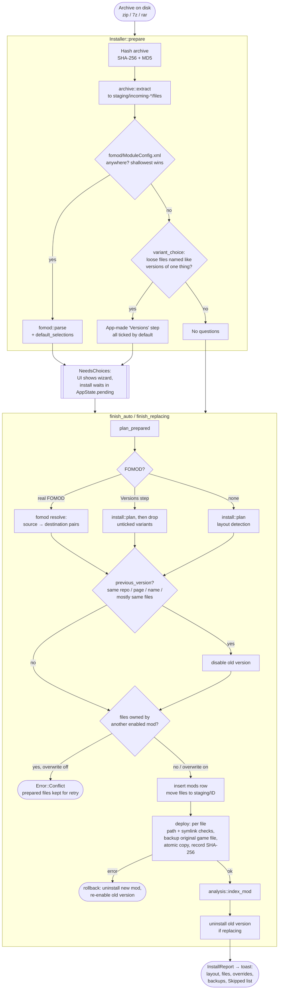

# Install pipeline

Back to [[Home]]. Same flow as a board: [[Install flow.canvas]].

Every install, whatever started it ([[Entry points]]), runs through
`main.rs::begin_install` and then `core::install::Installer`:

## Where each box is explained

| Step | Note | Code |
|---|---|---|
| Hash + extract | [[Archive extraction]] | `Installer::prepare`, `archive::extract` |
| FOMOD / Versions | [[FOMOD]] | `fomod::find_config`, `install::variant_choice` |
| Where files go | [[Layout detection]] | `install::plan` |
| Replace older version | [[Versions and replacing]] | `previous_version`, `finish_replacing` |
| Conflicts, deploy, record | [[Deploy and tracking]] | `conflicts`, `finish`, `deploy` |
| After the copy | [[After install]] | `analysis::index_mod` |

## What the user sees

- The toast built in `app.js` (after `install_archive` / `finish_install`):
  `Installed <name>: N files (<layout>)`, replaced version, overridden mods,
  backed-up game files, and the **first five** skipped files.
- Every step also lands in the debug terminal through `core::activity`
  (Hashed, Extracting, Copied, Saved the original, Installed … layout).
- The layout name (`game-root`, `redmod`, `cet-mod`, `radioext-station`, `reshade`, `loose`,
  `engine-config`, `fomod`) is the quickest clue when a mod lands in the wrong
  place. See [[Known gaps]].
