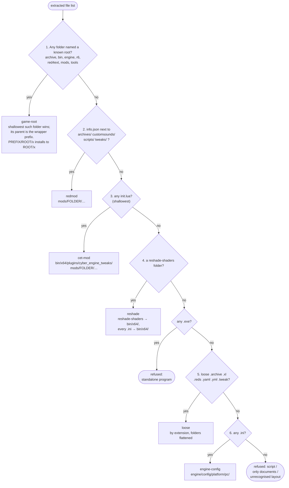

# Layout detection

Back to [[Home]] · previous: [[FOMOD]] · next: [[Deploy and tracking]].

Code: `install::plan(files, mod_name)`. Runs for every archive without a real
FOMOD installer (and under the app's *Versions* step). **The first rule that
matches decides the whole archive**; files the chosen rule doesn't place are
*skipped*, not installed. That one-rule-per-archive design is behind most of
the [[Known gaps]].

## Target paths per layout

| Layout (shown in the toast) | Trigger | Where files go | Everything else |
|---|---|---|---|
| `game-root` / `game-root (inside 'X')` | a known root folder at any depth | path below the wrapper prefix, unchanged | skipped, incl. files directly in the prefix and **other wrappers** |
| `redmod` | `info.json` whose folder has `archives/`, `customsounds/`, `scripts/` or `tweaks/` | `mods/<info.json's folder name or mod name>/…` | skipped if outside that folder |
| `cet-mod` | shallowest `init.lua` | `bin/x64/plugins/cyber_engine_tweaks/mods/<its folder or mod name>/…` | skipped if outside that folder |
| `reshade` | a `reshade-shaders` folder | `bin/x64/reshade-shaders/…`, any `.ini` → `bin/x64/<name>.ini` | skipped |
| `loose` | `.archive`, `.xl` | `archive/pc/mod/<file name>` | skipped |
| | `.reds` | `r6/scripts/<mod name>/<file name>` | |
| | `.yaml` `.yml` `.tweak` | `r6/tweaks/<mod name>/<file name>` | |
| `engine-config` | only `.ini` files (no loose mod files) | `engine/config/platform/pc/<file name>` | skipped |
| `fomod` | real FOMOD installer ([[FOMOD]]) | installer destinations | *named by installer, not in archive* |

`<mod name>` is `sanitize_folder(name)`: ASCII letters, digits, `-`, `_`,
space; anything else becomes `_`.

## Refusal messages

Checked in this order, on the shallowest match:

1. any `.exe` → "standalone program (X.exe), not a game mod" (e.g. WolvenKit,
   save editors). Note: only reached when rules 1–4 didn't match.
2. `.bat` `.cmd` `.ps1` `.sh` → "a script (X), not a game mod".
3. every file is a document or picture → "only has documents or pictures".
4. otherwise → "unrecognised archive layout … install location can't be
   determined".

## Writing to disk

`plan` only produces relative targets. [[Deploy and tracking]] maps them onto
real folders case-insensitively (`resolve_ci`), so `Archive/PC/Mod` from an
archive lands in the existing `archive/pc/mod`.

## Tests

`install::tests::plans_common_layouts` covers one example per row above and
the refusal messages. A new rule or a fixed gap needs a case there.
