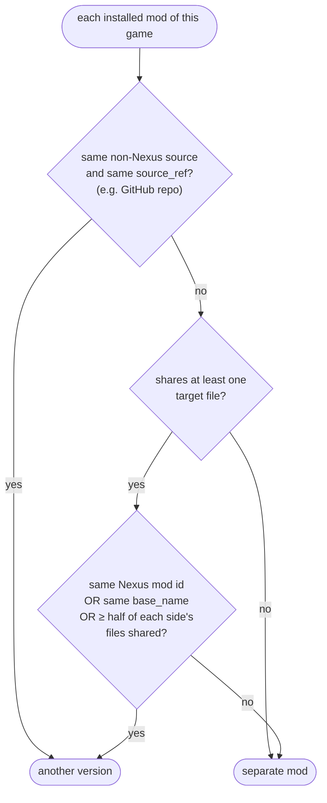
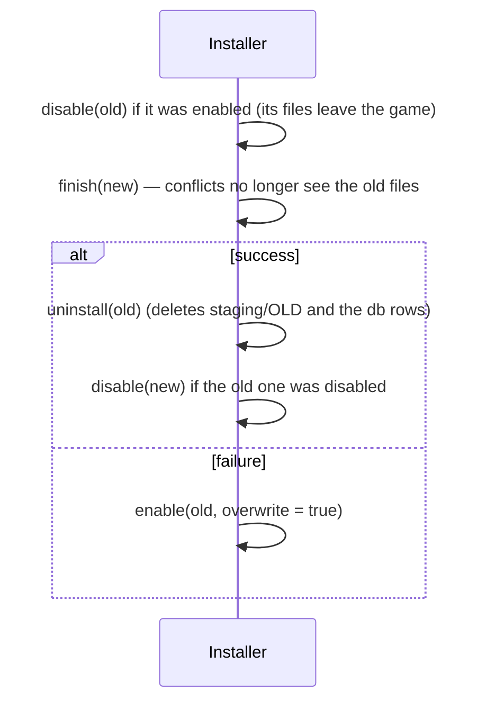

# Versions and replacing

Back to [[Home]] · previous: [[Deploy and tracking]] · next: [[Disable, enable, uninstall, verify]].

Code: `Installer::finish_auto`, `Installer::previous_version`,
`Installer::finish_replacing`, `base_name`.

`finish_auto` plans the archive first, then asks `previous_version` whether an
installed mod (enabled or not) is an older version of it. Callers that already
know (Downloads **Switch to this**, **Update**, ReShade, radio stations) pass `replaces` and
call `finish_replacing` directly.

## Same mod or not

The mod with the most shared files wins. `base_name` drops numbers, a leading
`v` and punctuation: "ArchiveXL 1.2.3" = "ArchiveXL-v1.3". An optional file
from the same Nexus page that shares no file with the main file stays a
separate mod.

## Replacing

The report's `replaced` ("Mod 1.2") shows in the install toast.
