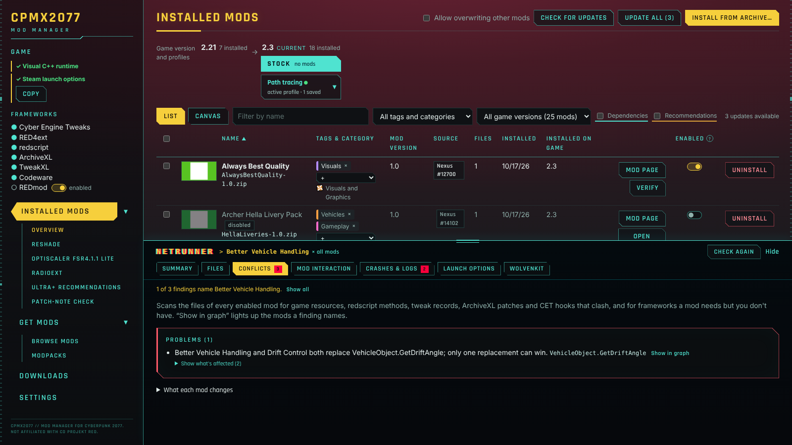
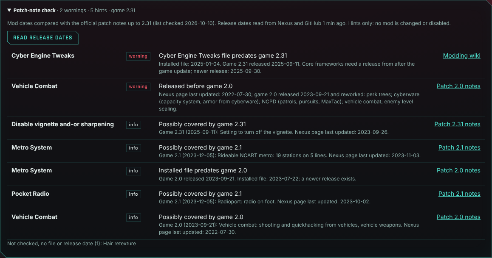
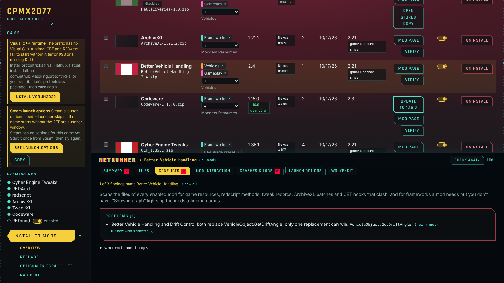
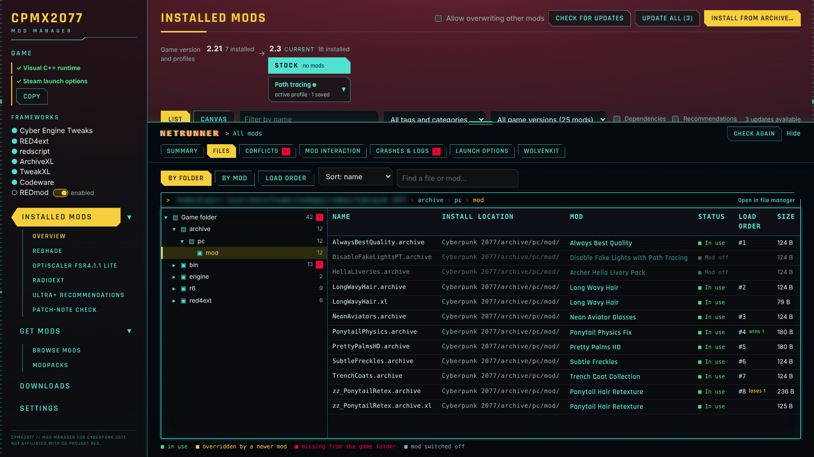
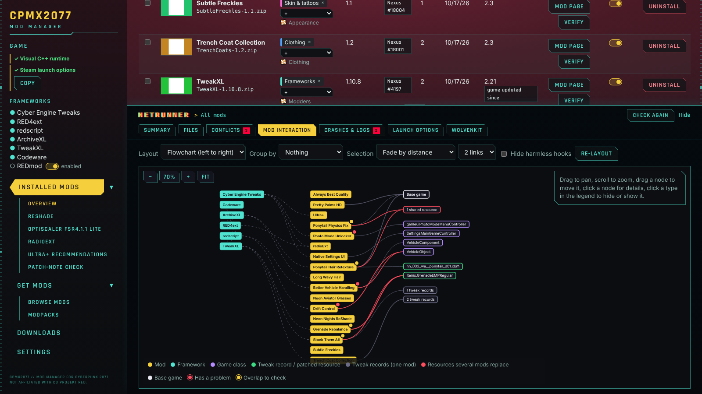
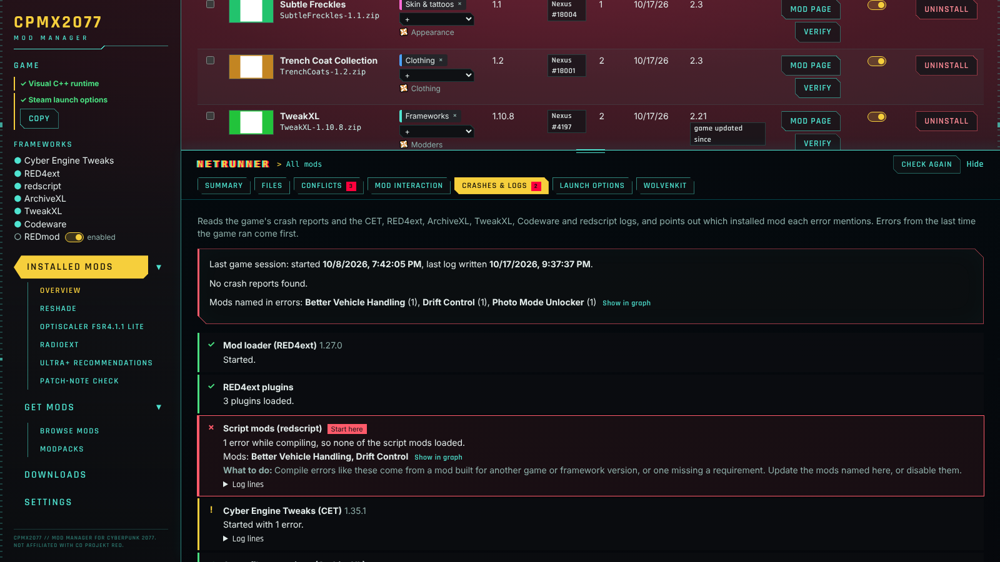

# CPMX2077 user guide

A reference for how CPMX2077 works and what each part of the window does.
New here? Start with [Getting started](getting-started.md). Screenshots
show sample data, with file locations blurred.

The app shows tab names, buttons and headings in capitals (INSTALL FROM
ARCHIVE…); this guide writes them in normal case (**Install from
archive…**). The selected tab is the amber one in the left menu.

Two tabs have sections listed under them in the left menu: **Installed
mods** (**Mod list**, **ReShade**, **OptiScaler**, **RadioEXT**, **Ultra+
recommendations**, **Patch-note check**) and **Get mods** (**Browse mods**,
**Modpacks**). **▾** next to the tab shows or hides its sections; the choice
is kept. A section shows in the menu once it applies: ReShade and Patch-note
check once a mod is installed, Ultra+ recommendations once Ultra+ is in the
game. OptiScaler and RadioEXT show whenever a game is selected.

- [How it works](#how-it-works)
- [Game panel](#game-panel)
- [Installed mods](#installed-mods)
- [Modpacks](#modpacks)
- [Netrunner](#netrunner)
- [Get mods](#get-mods)
- [Downloads](#downloads)
- [Settings](#settings)
- [Download safety](#download-safety)
- [Letting Claude look at your mods (MCP)](#letting-claude-look-at-your-mods-mcp)
- [Where things are stored](#where-things-are-stored)
- [Troubleshooting](#troubleshooting)

## How it works

CPMX2077 installs mods straight into the game folder, the way the mods'
authors describe, and remembers every file it put there.

1. **Get an archive**: from Nexus Mods, from a GitHub release, or a `.zip`,
   `.7z` or `.rar` you already have. Downloads are verified before anything
   is unpacked (see [Download safety](#download-safety)) and kept in the
   download folder, one folder per mod.
2. **Work out the layout**: the archive is unpacked into a staging folder
   and the app decides where each file goes:
   - a **FOMOD installer** runs as a wizard where you pick options;
   - files already laid out like the game folder (`bin/`, `archive/`,
     `r6/`, `red4ext/`, `engine/`, `mods/`) go where they say, even inside
     an extra wrapper folder;
   - a CET mod folder (with `init.lua`) goes to
     `bin/x64/plugins/cyber_engine_tweaks/mods/`;
   - a REDmod folder (`info.json` plus `archives/`, `scripts/`, …) goes to
     `mods/`;
   - loose `.archive`, `.xl`, `.reds` and tweak files go to their usual
     folders, loose `.ini` files to `engine/config/platform/pc/`, and ReShade
     presets (an `.ini` with a `Techniques=` line) to `bin/x64/`;
   - an archive holding alternative packs (for example several presets)
     asks which one you want in a **Versions** step;
   - readmes and screenshots are skipped, and downloads that are not game
     mods (only documents, a script, or a standalone program such as a save
     editor) are refused with a message saying why.
3. **Deploy**: each file is written with a safe temp-file-and-rename. If a
   file belongs to another mod, the install stops unless you tick **Allow
   overwriting other mods**. Original game files that get replaced are backed
   up first.
4. **Record**: the library database stores the mod, its source, version,
   the game build it was installed on, the archive's checksums and every
   installed file with its SHA-256. A staged copy of the mod is kept so it
   can be switched off and on again without downloading.
5. **Index**: every enabled mod is scanned for what it touches (game
   resources in `.archive` files, redscript methods, TweakXL records,
   ArchiveXL patches, CET hooks, RED4ext plugins). This index drives the
   compatibility check, the graph and the dependency list.

Uninstalling reverses step 3: the mod's files are removed, a file another
mod had installed underneath comes back, and backed-up game files are
restored.

Installing another version of a mod you have replaces it in place: the old
files come out, the new ones go in, and a disabled mod stays disabled. It
counts as the same mod when it comes from the same GitHub repository, or
when it installs some of the same files and comes from the same Nexus page,
has the same name apart from version numbers, or mostly overlaps. An
optional file from the same Nexus page that shares no files with the main
one is installed next to it instead.

## Game panel

The top of the left-hand menu: the setup items and frameworks of the
install the rest of the app works on. The install list itself (with each
install's folder, version and prefix) is in
[Settings › Game installs](#settings). A drop-down to switch installs shows
here only when more than one is found; while none is found, the panel has
**Rescan** and **Add path…**.

To make the left-hand menu wider or narrower, drag the line between it and
the main area left or right. The width is kept the next time you open the
app, and a docked debug terminal fills whatever width you choose. Double-click
the line to put it back to the default. With the line selected (Tab to
it), the left and right arrow keys also resize it.

- **Linux setup items**: what mods need from Proton/Wine, each with a fix
  button and, after a fix, **Undo**. Every fix asks for confirmation first,
  and the app offers fixes on its own after you install a mod that needs one
  (after a download queue, once the whole queue has finished).
  - *Visual C++ runtime* → **Install vcrun2022** (protontricks, Flatpak
    protontricks, or winetricks with the game's own Proton).
  - *Steam launch options* → **Set launch options** writes
    `WINEDLLOVERRIDES="winmm,version=n,b" %command% --launcher-skip` (plus
    `-modded` when REDmod mods are installed and the REDmod switch is not
    off). `--launcher-skip` starts the game without CD Projekt's
    REDprelauncher window; its Enable mods setting is replaced by the REDmod
    switch under **Frameworks**. With ReShade in the game, its DLL and
    `d3dcompiler_47` join the list:
    `WINEDLLOVERRIDES="winmm,version,dxgi,d3dcompiler_47=n,b" %command% --launcher-skip`.
    With OptiScaler in the game, the name it loads as (`wininet` or `dxgi`)
    joins the list too.
    Other variables and overrides already in your launch options are kept.
    Only works while Steam is closed. **Copy** copies the whole line to paste
    yourself.
  - *Shader compiler for ReShade* (only with ReShade installed) →
    **Install d3dcompiler_47** installs Microsoft's shader compiler into the
    prefix with protontricks or winetricks (winetricks takes the DLL from
    Mozilla's Firefox installer). Wine's own `d3dcompiler_47` fails to
    compile many ReShade effects.
  - *DLL overrides* (Heroic) → **Set overrides** sets `winmm` and `version`
    (and ReShade's DLL and `d3dcompiler_47` with ReShade installed, and
    OptiScaler's DLL with OptiScaler installed) to native-then-builtin in the
    prefix.
  - *FSR 4 shader overrides* (only after you pick **Exact** or **Lossy** in
    the [OptiScaler](#optiscaler) section) → **Set launch option** puts
    `VKD3D_SHADER_OVERRIDE='Z:<folder>'` in front of your launch options,
    keeping everything else. With **Off** picked while the variable is still
    set, **Remove launch option** takes it out. Steam closed only; on Heroic,
    **Copy** gives the variable to add under the game's environment
    variables.
  - *Folder names* → **Merge folders** joins mod folders that exist under two
    spellings.
  - *HDR* (only when a connected display lists HDR10/PQ in its EDID) →
    **Set HDR launch options**. Lists what was checked: the display, the
    session (Wayland or X11), the desktop and whether its HDR is enabled
    (read from `kscreen-doctor` on KDE; *not checked* elsewhere), the GPU
    driver (`/proc/driver/nvidia/version` or `vulkaninfo`) and the Proton
    build that last ran the prefix. Requirements:
    - Wayland session with HDR enabled in the desktop's display settings
      (KDE Plasma 6: System Settings › Display & Monitor › Enable HDR;
      GNOME 48 or newer: Settings › Displays). X11 has no HDR output.
    - Mesa 25.1 or newer, or NVIDIA 595 or newer. Older drivers work only
      with `vk_hdr_layer` installed; the app then adds `ENABLE_HDR_WSI=1`.
    - GE-Proton 10 or newer, or proton-cachyos: the button adds
      `PROTON_ENABLE_WAYLAND=1 DXVK_HDR=1`. Valve's Proton has no Wine
      Wayland driver; with `gamescope` installed the button adds
      `DXVK_HDR=1 gamescope -W <width> -H <height> -f --hdr-enabled --force-grab-cursor -- `
      before `%command%` instead (size from the display's preferred mode).
      `--force-grab-cursor` keeps the mouse captured in gamescope; without
      it the camera stops turning at the window edge. A wrapper set by an
      earlier version without it is marked as a problem, and the button adds
      it. With gamescope in use, the item names GE-Proton 10 or newer
      (Steam › Properties › Compatibility) as the way to output HDR without
      gamescope.
      Without either: select GE-Proton in Steam › Properties › Compatibility.
    - Both methods work (GE-Proton 10+ or proton-cachyos, and `gamescope`
      installed): **Set HDR launch options** uses Wine's Wayland driver, and
      **Set HDR with gamescope** uses the gamescope wrapper instead. Once one
      is set, **Use gamescope instead** or **Use Wayland instead** swaps the
      HDR settings and keeps the rest of the launch options. The Wayland
      method runs without a nested compositor, so the mouse is never
      confined to a gamescope window.
    Other launch options are kept; **Undo** removes only the HDR variables
    and the HDR `gamescope` wrapper. Only works while Steam is closed. With
    Heroic, **Copy** copies the variables for Heroic › game settings ›
    Advanced › Environment variables. Once set, pick *HDR10 PQ* in the game's
    Settings › Video › HDR Mode.
    The item stays a problem while the desktop runs the display in HDR and
    the game can't use it (the game then renders SDR inside an HDR signal).
    When the desktop reports HDR disabled on every display, it shows as
    *✓ HDR (desktop in SDR mode)*; desktops that aren't checked count as HDR.
- **Frameworks**: CET, RED4ext, redscript, ArchiveXL, TweakXL, Codeware and
  REDmod, highlighted when present in the game folder. While any of the six
  GitHub frameworks is missing, **Install missing frameworks** under the
  list queues them from GitHub, each after what it needs (REDmod ships with
  the game). Framework problems such as *ArchiveXL is installed but
  RED4ext is missing* are listed above with the same button.
- **REDmod switch** (next to *REDmod*, when `tools/redmod` is in the game
  folder): enables or disables REDmod mods (folders in `mods/`) without
  the REDprelauncher. *enabled* means `-modded` is in Steam's launch
  options; the game then deploys changed REDmods itself at start. Switching
  adds or removes `-modded`, always adds `--launcher-skip`, and is kept:
  **Set launch options** does not add `-modded` back while the switch is
  off. Only works while Steam is closed (Linux and Windows). Hover for the
  number of REDmod mods found. For GOG, Epic and Heroic the switch is
  greyed out (*not Steam*): add `-modded --launcher-skip` to the game
  arguments in that launcher.

## Installed mods



The list of mods CPMX2077 installed in the selected game (**Mod list** in
the menu).

**First setup** checklist: on top of the list while a first-run step is
open. *Core frameworks* (**Install missing frameworks**), *Linux setup*
(**Fix now** offers every open fix in one dialog; not on Windows) and
*Nexus account* (**Connect in Get mods**), each ticked once done. **Hide**
removes it; the same buttons stay in the Game panel and Get mods.

| Column / control | What it does |
|---|---|
| Selection box (first column) | Selects the mod for the actions in the selection bar. It changes nothing on its own; see *Selecting several mods* below. |
| Picture | The mod's thumbnail from its Nexus page, fetched once and saved in `~/.cache/cp2077-modmanager/thumbnails/` (Windows: `%LOCALAPPDATA%\cp2077-modmanager\thumbnails`), so the list shows it offline. Needs a connected Nexus account the first time; a plain box stands in for mods without a Nexus page or picture. The picture URL is checked against Nexus again after 30 days. |
| **Name / Tags & category / Mod version / Source** | Click a heading to sort (*Tags & category* sorts by a mod's first tag, then its Nexus category). **Mod version** is the mod's own version (the game version is under **Installed on game**). A mod's tags show as chips: **+ Tag** (or **+** once it has one) adds one of your tags (see [Modpacks](#modpacks)), **×** on a chip takes it off. A mod can have any number of tags. The Nexus category is shown under them. |
| **Installed on game** | The game version when the mod went in. *game updated since* means the game has been patched since: red when an update or the patch-note check names the mod, plain when neither does (hover for both builds). A second badge comes from the [patch-note check](#patch-note-check): *predates game 2.31* (a core framework older than a game patch), *before game 2.0* (released before a patch that reworked the systems mods build on), *in base game 2.1?* (a patch added what the mod does), *unlisted on Nexus*. Hover it for the details. |
| **Update to …** | Appears when a newer file is available. *Switch to stable …* appears when you run a pre-release and a stable release is out. |
| **Mod page** | Opens the mod's page in **Get mods** (description, files, requirements), for mods from Nexus or GitHub. From there **Open on nexusmods.com** opens the website. Not shown for mods installed from an archive on disk. |
| **Verify** | Re-hashes the mod's files and reports missing, edited or overridden ones. |
| **Enabled** switch | The slider next to **Uninstall**. Off disables a mod without uninstalling it: its files leave the game, whatever they replaced comes back, and a checked copy is kept. On puts them back without a download. Files the mod changed after install (its own settings) are kept. Disabled mods are left out of compatibility and crash checks. Hover the **Enabled** heading for the difference to **Uninstall**. |
| **Uninstall** | Removes the mod and its stored copy and restores what it replaced. Files changed after install (the mod's own settings) stay in the game and are no longer tracked. The downloaded archive stays in **Downloads**, so the mod can be installed again from there. |

**Enabled** vs **Uninstall**: switching **Enabled** off keeps the mod in the
list with a stored copy, so it can come back without a download.
**Uninstall** deletes the stored copy and removes the mod from the list; the
confirmation says so and points at **Enabled** for keeping it.

### Selecting several mods

- Tick the box in the first column of each mod. **Shift**-click a second box
  to select every mod between the two. The box in the header selects every
  mod the current filters show.
- With at least one mod selected, a bar above the list shows the count and:
  - **Enable**: switches the selected disabled mods on. A mod whose files
    conflict with an enabled mod is left off and named in the report; switch
    it on with its own **Enabled** switch to choose which mod's files win.
  - **Disable**: switches the selected enabled mods off.
  - **Add tag…** / **Remove tag…**: puts one of your tags on every selected
    mod, or takes it off (shown once you have tags).
  - **Uninstall**: one confirmation lists every selected mod, then uninstalls
    them, newest install first, so files one mod replaced are put back in
    order.
  - **Clear selection**.
- Changing the filter drops hidden mods from the selection, so an action only
  touches mods on screen.

Above the list:

- **Allow overwriting other mods**: lets the next install replace files that
  belong to another mod. Uninstalling the winner later restores the loser's
  copy.
- **Check for updates** asks Nexus and GitHub for newer files (also runs at
  start-up). **Update all** checks first (unless a check ran in the last
  10 minutes), then lists every mod with a newer file, current version →
  new version, and asks **Proceed** or **Cancel**. **Proceed** puts them all
  in the download queue: GitHub files and Nexus files on a Premium account
  download through the API; on a free account the Nexus window steps
  through the files, one **Mod Manager Download** click each. Each update
  replaces the installed version and keeps its tags.
- **Install from archive…** installs a `.zip`, `.7z` or `.rar` from disk.
- **Game version and profiles**: one column per game version the app has
  seen, oldest on the left, with that version's mod profiles (named lists
  of enabled mods) as chips under it. Each profile chip shows its name, mod
  count and what applying it would change; *active* (green dot) means the
  enabled mods match it now. Click a chip to show its actions under the
  ribbon.
  - The current version's own chip (*stock · no mods*) is the stock game:
    **Apply** disables every enabled mod (stored copies are kept; files not
    installed by CPMX2077 stay in the game folder) and removes a load order
    set in CPMX2077. When the enabled mods
    match no profile, it first offers to save them as *Before stock*, so
    one click brings them back.
  - **+ Profile** (current version only): type a name and click **Save N
    enabled mods as profile**. Names are up to 60 characters and unique per
    game version.
  - On a profile:
    - **Apply**: one confirmation lists the mods to enable, to disable and
      the profile's mods that are no longer installed (skipped). Then it
      enables the profile's mods and disables every other installed mod,
      in the same game folder. A mod whose files conflict with an enabled
      mod stays off and is named in the report. A profile saved under an
      older game version can be applied too; the confirmation names both
      versions, since mods may need updates.
    - **Update from enabled mods**: replace the profile's list with the mods
      enabled now (and the archive [load order](#file-map)).
    - **Rename**, **Delete** (installed mods are not changed).
  - Mods are matched by their Nexus mod, source listing or (manual installs)
    name, so a mod updated after the profile was saved still counts. Where a
    mod has several files installed (main plus optional file), only the
    files in the profile are enabled.
- **Filter by name**: shows mods whose name or archive name contains the
  text.
- **Tag and category filter**: one of your tags (or *No tags*), or a Nexus
  category.
- **Game version filter** (with two or more game versions seen): the mods
  installed on one version. For an older version, a summary shows what you
  had when the game updated and what changed since (updated, turned off,
  removed, added).
- **Dependencies** and **Recommendations** are two checkboxes that add rows
  under each mod; turn on either, both, or neither (plain list). With both
  on, each mod's dependencies come first, then its recommendations, each row
  in its own colour.
- **Dependencies** (teal rows) lists what each mod needs, indented under it:
  its Nexus page's requirements and the frameworks its files use (redscript
  for `.reds`, ArchiveXL for `.xl`, …). Each is marked installed, turned off,
  already in the game folder, or missing, with a button to get it (**Turn
  on**, **Install** from GitHub, **Get from Nexus**, or **Open link** for
  off-site requirements). The requirements come from each mod's Nexus page,
  asked again once a day, so a requirement you have never installed still
  shows up as missing. A requirement hosted outside Nexus whose presence
  can't be checked is marked **not verified**. A mod with nothing found in
  either source shows "No requirements listed on its Nexus page; no
  framework use found in its files" (or "No Nexus page to read requirements
  from" for mods not installed from Nexus). Under a mod that others need, a
  "Needed by" line names them.
- **Recommendations** (amber rows) lists the Nexus requirements whose
  author's note marks them optional: notes such as "optional",
  "recommended", "only if you want …" or "not required". A requirement the
  mod's files use is always a dependency, whatever its note says. Under a mod
  that others recommend, a "Recommended by" line names them.
- **Missing on top** (on by default) puts a block above the mods with each
  missing dependency once (and, below it, each missing recommendation), the number of turned-on mods
  that list it in front, most first, and the mods that list it. Mods with
  something missing sort above the rest, keeping the column sort within each
  part.
- The line next to the buttons counts what is missing for your turned-on
  mods, and **Get missing (N)** queues all of it at once (whatever the
  checked boxes show): core frameworks from GitHub,
  everything else from Nexus.

### Ultra+ recommendations

When [Ultra+](https://www.nexusmods.com/cyberpunk2077/mods/10490) (the path
tracing mod) is installed, through CPMX2077 or by hand or with Ultra+
Manager, **Ultra+ recommendations** appears under Installed mods in the
menu. It shows
what the Ultra+ team's
[Cyberpunk page](https://theultraplace.com/games/cyberpunk2077/) lists, and
where each mod stands in your game. The heading line sums it up (conflicting
mods installed, how many recommended mods you have, and a missing
requirement).

- **Conflicts with Ultra+ path tracing**: mods the Ultra+ team says don't
  work with its path tracing. Ones you have are marked *installed* in red,
  with **Turn off**. Also listed: RedHotTools, which Ultra+ itself checks for
  at start-up because it turns Ultra+'s V5 lighting off.
- **Recommended for path tracing and ray tracing**: mods the Ultra+ team
  suggests alongside it, with notes such as The Nullifier's "set 'Fix Broken
  PT Lights' to disabled". **Get** adds a missing one to the download queue,
  **Turn on** switches one back on, and **Get all missing** queues them all.
- **Also recommended for ray tracing only**: Ultra+ doesn't fix ray traced
  lighting, so the Ultra+ team suggests these when you play with ray tracing.
  Several of them are in the conflicts list too, since they don't belong in a
  path tracing setup.
- **Required** appears only when Cyber Engine Tweaks or RED4ext is missing.
- **Refresh from Ultra+ page** reads the lists again from the Ultra+ team's
  page (its public source on GitLab) and keeps them. Until you do, the card
  uses a copy built into the app; the line under the heading says which.
- **Open the Ultra+ page** opens the page in your browser. **Open Project
  Ultrapunk modpack** opens the collection the page suggests instead of
  adding mods one by one.

*not installed* means CPMX2077 didn't install it; a mod you copied in by hand
can't be told apart by name. Installed conflicts and the setting notes also
show under **Known problems** in Netrunner's
[Crashes & logs](#crashes--logs).

### Patch-note check



The **Patch-note check** section (under Installed mods in the menu) compares each turned-on mod's dates with the
game's official patch notes (cyberpunk.net), from Hotfix 1.04 to Patch
2.31. The list is built into the app; the line under the heading says when
it was last compared with the official notes. The heading line counts
warnings and hints and shows the game version used (from the game's exe;
when it can't be read, every listed patch counts). Click it to unfold the
card. Nothing is changed or turned off: these are hints.

Dates used:

- **File date**: Nexus puts the upload time in every file name, so mods
  installed from Nexus are dated without asking Nexus anything.
- **Read release dates** asks Nexus (one request per 50 mods) for each mod
  page's last update, summary and page status, and GitHub for release dates,
  and keeps them in the library database. Without a Nexus API key only
  GitHub is read. Mods that couldn't be read are listed under the buttons.

What it reports, warnings first:

| Finding | When |
|---|---|
| **… file predates game X** (warning) | A core framework (Cyber Engine Tweaks, RED4ext, redscript, ArchiveXL, TweakXL, Codeware) installed from a file older than a game patch you have, while a newer release exists. The modding wiki's rule: after a game update every core framework needs a release from after that update. Shown as a hint until **Read release dates** confirms the newer release; not shown when the source has nothing newer. |
| **Released before game 2.0** | The mod's last update (or, before reading dates, its file) is older than Update 2.0, which reworked perk trees, cyberware, the NCPD, vehicle combat and enemy scaling. A warning for mods with scripts, CET, plugins or TweakXL files; a hint for mods with only archives. **Installed file predates game 2.0** means a newer release exists. |
| **Possibly covered by game X** | The mod's name or Nexus summary matches a feature that patch added (NCART metro, Radioport, wardrobe/transmog, AutoDrive, the vignette toggle, FSR 3 frame generation, …) and the mod wasn't updated after that patch. Some mods are matched by their Nexus id. |
| **Nexus page status: …** | The Nexus page is hidden, removed or otherwise no longer published (known after **Read release dates**). |

Each row links the patch notes or the modding wiki page it is based on.
Mods without any date (installed from an archive on disk, or from a source
without dates) are listed at the bottom as *Not checked*.

### ReShade


The **ReShade** section (under Installed mods in the menu) installs
[ReShade](https://reshade.me/), the post-processing injector used for
sharpening, colour grading and presets, and keeps it up to date. Its heading
line shows the installed version and the DLL name it loads as, or *not
installed*. Click the heading to open or fold the card.

- **Install ReShade** reads the newest version from reshade.me, downloads
  the standard setup (`ReShade_Setup_<version>.exe`, not the add-on build)
  from reshade.me only, and takes `ReShade64.dll` out of it. Before
  installing, the app checks that the DLL is a 64-bit Windows DLL, that its
  version information names ReShade, and that its version matches the setup's
  file name. reshade.me publishes no checksums, so the SHA-256 of the setup is
  recorded and shown as **Setup SHA-256** instead.
- **Install from setup file…** does the same with a setup you downloaded
  from reshade.me in your browser, for when the app can't reach the site.
- ReShade goes in as `bin/x64/dxgi.dll`, the name it loads under in a
  DirectX 12 game. If another program (an upscaler or another injector)
  already uses `dxgi.dll`, it goes in as `bin/x64/d3d12.dll`; if both names
  are taken, the card names what's using them and installs nothing. A ReShade
  you copied in yourself is backed up and put back when you uninstall.
- If the game has no `bin/x64/ReShade.ini`, the app writes one that points
  ReShade at `bin/x64/reshade-shaders/` for effects and textures. An existing
  `ReShade.ini` is left alone.
- ReShade is listed in the mod table like any mod (source *reshade.me*), so
  the **Enabled** switch, **Verify**, **Uninstall** and the File map work on it.
  The card has **Disable**/**Enable** and **Uninstall** too.
- **Check for updates** reads the newest version from reshade.me and the
  newest commit of each installed shader pack. When ReShade is newer,
  **Update to &lt;version&gt;** installs it in place of the old one under the
  same DLL name; ReShade's settings and your presets stay. A pack with a newer
  commit shows **Update**.
- **Uninstall** removes the DLL, the `ReShade.ini` the app wrote (with any
  changes ReShade made to it) and ReShade's log. Presets you made
  (`ReShadePreset.ini` and others) stay in `bin/x64`.

On Linux the card also shows what ReShade needs from Proton:

- **Launch options** (Steam) or **DLL overrides** (Heroic): *set* when Wine
  loads ReShade's DLL from the game folder first. *not set* shows the line to
  use, with **Copy**; **Set launch options** in the Game panel writes it for
  you while Steam is closed. Without it, ReShade may not load.
- **Shader compiler**: *d3dcompiler_47 native*, or *Wine builtin* with a
  pointer to **Install d3dcompiler_47** in the Game panel.

Right after ReShade is installed, the app offers both fixes in one dialog,
like it does after installing CET or RED4ext. On Windows none of this is
needed and the rows don't show.

**Shader packs** lists effect collections from their authors' GitHub
repositories: Standard effects (the ones ReShade's own installer offers),
SweetFX, qUINT, iMMERSE, prod80, AstrayFX and FXShaders. **Install**
downloads the newest commit of that repository from GitHub and installs only
its shader files (`.fx`, `.fxh`) and textures, each pack in its own folder:
`bin/x64/reshade-shaders/Shaders/<pack>/` and
`bin/x64/reshade-shaders/Textures/<pack>/`, so packs that ship the same
header don't collide. Scripts, readmes and anything else in the repository
are left out. Each pack is a mod row too (*SweetFX (ReShade shaders)*),
with the commit date and id as its version, and **Disable**, **Enable** and
**Uninstall** next to it. GitHub publishes no checksums for these archives;
the commit id pins what was installed.

**Presets** lists the ReShade presets in `bin/x64` and its direct subfolders
(such as `bin/x64/reshade-presets/`): `.ini` files with a `Techniques=`
line, with the mod that installed each one. *active* marks the preset ReShade
loads, whether you picked it here or in ReShade's overlay; **Use** makes
another one active by setting `PresetPath` in `ReShade.ini`, from the next
game start.

*N effect files missing* names the effect files a preset uses that aren't
under `reshade-shaders/Shaders`. **Find shader packs** reads each listed
pack's file list on GitHub and shows which pack has each missing file, with
an **Install** button for a pack you don't have yet. Files no listed pack
ships show *not in a listed pack*; the preset's mod page says where to get
them.

Preset mods install like any other mod. Their `.ini` goes to `bin/x64` and
their shaders to `bin/x64/reshade-shaders`, so they show up here. A download
that is only a preset `.ini` (no folders) is recognised by its `Techniques=`
line and goes to `bin/x64`, not to the engine config folder like other loose
`.ini` files. A preset mod that bundles its own ReShade (`dxgi.dll`)
clashes with the ReShade installed here: the install stops and names the
file, and **Allow overwriting other mods** lets the mod's copy win. A
`ReShade.ini` in a preset mod replaces the one in the game folder; the old one
is backed up and comes back when you uninstall the preset mod.

In game, the Home key opens ReShade's overlay.

### OptiScaler

The **OptiScaler** section (under Installed mods in the menu) installs
[OptiScaler](https://github.com/optiscaler/OptiScaler), which takes the
game's DLSS, XeSS or FSR 3.1 input and runs another upscaler, FSR 4
included. Single-player only: OptiScaler's own page warns that anti-cheat
can ban for it.

- **Install OptiScaler** reads the newest stable release on GitHub
  (pre-releases and nightlies are skipped), downloads its archive and checks
  the SHA-256 GitHub publishes for it. Everything next to `OptiScaler.dll`
  goes to `bin/x64`; the setup scripts (`.bat`, `.sh`) are left out, since
  the app does their job.
- **Load as** picks the system DLL name OptiScaler loads under. OptiScaler's
  wiki lists `wininet.dll` and `dxgi.dll` for Cyberpunk 2077. `wininet.dll`
  is the default: `winmm.dll` and `version.dll` belong to RED4ext and CET,
  and ReShade usually has `dxgi.dll`. A name another mod or an untracked file
  already uses is refused, with the owner named.
- **Use AMD's FSR 4.1.1 upscaler DLL** (ticked by default) also downloads
  `amd_fidelityfx_upscaler_dx12.dll` 4.1.1.2740 from AMD's FidelityFX SDK
  2.3.0 on GitHub (a fixed commit). It must match its git blob id and name
  version 4.1.1.2740 in its version information, or nothing is installed.
  It replaces the upscaler DLL in OptiScaler's archive. The shader overrides
  below need exactly this file.
- OptiScaler is one mod row (source *GitHub optiscaler/OptiScaler*), so
  **Disable**, **Uninstall** and **Verify** work as for any mod.
  **Check for updates** reads the newest stable release; **Update to …**
  replaces the installed copy.
- The table shows the version, the DLL name, and *Upscaler DLL*: the
  version of `bin/x64/amd_fidelityfx_upscaler_dx12.dll` read from the file,
  marked *AMD 4.1.1.2740* or *not 4.1.1.2740*.
- On Linux, while Steam's launch options lack OptiScaler's DLL override, the
  *Steam launch options* item from the Game panel shows here with its
  **Set launch options** button.

In game: set the game's upscaler (Settings › Graphics › Resolution scaling)
to FSR 3.1 or XeSS, press Insert and pick FSR 4 in OptiScaler's overlay.
OptiScaler's wiki reports noise with DLSS input and path tracing on AMD
cards. The overlay also shows the upscaler time per frame.

**FSR 4.1.1 shader overrides** (Linux only) are faster replacements for
the shaders in AMD's FSR 4.1.1, from
[fsr4-shader-performance-overrides](https://github.com/zgauthier2000/fsr4-shader-performance-overrides).
vkd3d-proton loads them through the `VKD3D_SHADER_OVERRIDE` launch option.

- They match AMD's upscaler DLL 4.1.1.2740 only. With another version in
  `bin/x64` the section shows *no effect*.
- They are for Radeon RX 7000 and RX 6000 cards, not RX 9000. The
  repository measured 15 to 35% less FSR 4 time at 4K on RX 7000 cards in
  most reports, and little at 1080p on some cards.
- They were built from Proton's translation on an RX 7800 XT. On some
  setups the picture comes out wrong (darker); pick **Off** then.
- **Download shader overrides** reads the repository's newest commit and
  downloads every `.spv` file in `prebuilt/` and `prebuilt-lossy/`. Each file
  must match its git blob id from GitHub's file list, or the whole download
  is discarded and the previous files stay. **Download again** gets the
  newest commit.
- **Off**, **Exact** (AMD's picture, byte for byte) or **Lossy** (faster,
  runs FSR 4's network every other frame, so the picture differs; the app
  asks first and links the repository's `WARNING.txt`). The choice is per
  game.
- After **Exact** or **Lossy**, the *FSR 4 shader overrides* item appears
  here and in the Game panel with **Set launch option**. OptiScaler keeps
  showing the FSR version as plain 4.1.1; a lower upscaler time in its
  overlay shows the overrides apply.

### RadioEXT

The **RadioEXT** section (under Installed mods in the menu) lists
the custom stations of [radioExt](https://github.com/justarandomguyintheinternet/CP77_radioExt)
and creates new ones from your own music. radioExt needs CET and RED4ext.
Each station is a folder in
`bin/x64/plugins/cyber_engine_tweaks/mods/radioExt/radios/` holding a
`metadata.json` (name, FM number, volume, icon, stream, play order) and the
song files. radioExt shows each song under its file name.

The top rows show whether radioExt's CET part (`init.lua`) and RED4ext part
(`red4ext/plugins/RadioExt/RadioExt.dll`) are in the game. While either is
missing, **Install radioExt** queues radioExt's newest release from GitHub.

The station table, sorted by FM number:

| Column | What it shows |
|---|---|
| **FM** / **Station** | The FM number and in-game name, with the folder name and where the station comes from: *made in CPMX2077*, *from &lt;mod&gt;* (installed with a mod), or *not tracked* (copied in by hand). Red badges name what radioExt would report in its CET console: no `metadata.json`, an unreadable `metadata.json`, no songs on a station that isn't a stream, or a play order naming a missing file. |
| **Songs** | Number of song files, *stream* for a web-stream station, *fixed order* when a play order is set. |
| **Icon** | The UIIcon record, or the `.inkatlas` part for a custom icon. |
| **State** | *enabled*, or *disabled* for a station switched off here. |

Buttons per station:

- **Edit** opens the editor. Shown for stations made here and for
  *not tracked* folders. Saving a *not tracked* folder installs it as a
  station made here: from then on it is tracked like any mod.
- **Open folder** opens the station's folder.
- **Disable** / **Enable** and **Delete** (stations made here): the same
  as the mod list's **Enabled** switch and **Uninstall**.

Stations installed with another mod aren't edited here; change them through
that mod. Archives of radioExt stations from Nexus install like any other
mod. An archive with station folders but without the game path
(`StationName/metadata.json` plus songs, or a `radios/` folder) goes into
radioExt's `radios` folder, one folder per station.

**New station** opens an empty editor:

- **Station name**: shown in game. radioExt's convention puts the FM number
  first (*99.9 Night City Nights*); a leading number follows the **FM**
  field.
- **FM**: sorts the station into the radio list (0.1–999.9).
- **Volume**: multiplier for the whole station (1.0 = unchanged), to match
  vanilla stations.
- **Icon**: a `UIIcon.` record from the game's TweakDB, such as
  `UIIcon.alcohol_absynth` (radioExt's template). Suggestions list the icons
  the other stations use. **Custom icon from an .inkatlas** uses a texture
  from an installed archive mod instead: **inkatlas path** (resource path
  with backslashes) and **inkatlas part**. `.inkatlas` files are made with
  WolvenKit.
- **Web stream**: plays an internet audio stream (**Stream URL**,
  `http://` or `https://`) instead of song files.
- **Add songs…** picks files. Accepted: mp3, mp2, flac, ogg, wav, wax, wma,
  opus, aiff, aif, aifc. Each file's first bytes are checked against its
  format; a file whose content doesn't match is refused, and one with the
  wrong extension (a FLAC named `.mp3`) gets the right one. opus and aiff are
  marked *recent radioExt only*: older radioExt versions skip them. Files are
  copied; the originals stay where they are.
- **Name from tags**: names added files *Artist - Title* from their ID3
  (MP3), FLAC or Ogg tags. Files without tags keep their name. Every name
  can be edited in the song list.
- **Play in this order**: writes the list order as radioExt's play order,
  with **↑** / **↓** to move songs. Off, radioExt plays the songs shuffled.
- **Remove** takes a song out of the station.
- **Create station** / **Save station** installs the station. It shows in
  the mod list with source *Radio station*. Saving changes installs the
  station again as a new version of the same mod; songs already in it are
  reused from the stored copy, not copied from the game folder. radioExt
  reads stations at game start.

## Modpacks

Under **Get mods** in the menu. Nexus collections, your own tags, and mod list import/export. Needs a
connected Nexus account for collections.

- **Search collections**: search Cyberpunk 2077 collections and sort by most
  endorsed, most downloaded, best rated, recently updated or newest.
- **Open a collection** to see each of its mods marked as installed, missing,
  turned off, or a different file than the collection lists. Then:
  - **Install required mods** queues the missing required ones;
  - **Install all, with optional** also queues optional ones;
  - a button replaces mods you have on another version with the file the
    collection lists;
  - **Follow** tracks the collection without installing anything;
    **Open on nexusmods.com** opens its page.
  While queued mods download and install, each missing mod's row shows its
  queue state (*downloading*, *waiting for FOMOD selections*, *failed: …*)
  and the list updates as each one finishes.
  Mods the collection lists from outside Nexus are named so you can get them
  by hand. Collection load order and bundled settings files are not applied
  yet.
- **Collections you follow**: installing from a collection follows it.
  **N required missing** opens the list of required mods not installed,
  each with its queue state or *not installed* (a failed install shows the
  reason).
  **Check for updates** asks Nexus for new revisions; **See what changed**
  shows what a revision adds, changes and drops, with one button to update.
  **Stop following** leaves its mods installed.
- **Your tags**: add tags with a name and color (a new tag starts with a colour no other tag uses), rename them or change their
  color, or delete them (a deleted tag comes off its mods; the mods stay
  installed). Give mods tags in Installed mods; a mod can have several. Tags
  stay with a mod through updates and can group the [graph](#graph). The
  list shows how many mods have each tag. (Older versions had one "custom
  category" per mod; those became tags automatically.)
- **Export mod list…** saves your mods, tags and followed collections to a
  JSON file. **Import mod list…** reads one, adds its tags (and gives your
  installed mods the tags the list has for them, on top of the ones they
  already have) and offers to get the mods you don't have. Mod lists exported
  by older versions, with categories, still import: their categories become
  tags.

## Netrunner



One place to see whether your setup is healthy (called Diagnostics in
earlier versions). **Check again** reruns every check. The top of the
tab summarises what needs attention: game setup problems, where the last
start went wrong (**Start here**), whether the game crashed in the last
session, errors from that session, known problem mods, and compatibility
problems. *Game setup* lists the same items as the Game panel: Linux setup
fixes still open (each with its fix button, such as **Install vcrun2022**)
and frameworks that are installed without what they need (with **Install
missing frameworks**). **Show in
graph** next to a finding lights up the mods involved. The links under the
title (**Files**, **Graph**, **Compatibility**, **Crashes & logs**) jump to
each section.

### File map



Every file your mods put into the game, laid out like the game folder, in
the style of a registry editor. Folders are on the left: click one to open
it and see what's inside on the right, or use the arrow keys (up and down to
move, right to open, left to close). The bar above shows where you are;
click any part of it to go back up, and **Open folder** opens that folder in
your file manager.

Each file shows its name, **Install location** (the folder it sits in inside the
game folder; click it to open that folder, hover for the full path), the
**Mod** it came from, its **Status** and its size:

- **In use**: the file is in the game folder and this mod's copy is the one
  the game loads.
- **Overridden by …**: a newer mod installed the same file over this one.
  Uninstalling or turning off the newer mod brings this copy back.
- **Missing**: the mod is on, but the file is gone from the game folder
  (deleted by hand or by another tool). **Verify** in Installed mods
  checks it in detail; reinstalling the mod puts it back.
- **Mod off**: the mod is switched off, so its files are kept outside the
  game until you turn it on again.

A red **!** next to a folder means something inside it is missing or
overridden. **By folder** / **By mod** switches between the game's folder
layout and one branch per mod (click a mod name in the list to jump to its
branch). In **By mod**, clicking a mod opens its whole folder structure at
once; the other mods stay collapsed. **Find a file or mod…** lists every file whose path or mod name
matches. The map only shows files CPMX2077 installed, not the game's own
files or mods installed by hand.

**Load order** (column and view). The game reads `.archive` files in a fixed
order, and when two archives contain the same resource, the one loaded
first is used:

- Archives in `archive/pc/mod` load first, sorted by file name in byte
  order (`!` and `_` and uppercase letters before lowercase), or in the
  order of `archive/pc/mod/modlist.txt` when that file exists (archives it
  doesn't list follow, by name).
- REDmod archives (`mods/<name>/archives`) load after all of them, so an
  archive mod always beats a REDmod on a shared resource.

The **Load order** column shows each loaded archive's position (**#3**),
counted over every archive in those folders, including ones not installed
by CPMX2077. **REDmod** marks REDmod archives. **wins N / loses M** counts
the resources the archive shares with other mods' archives that it wins
(loads first) and loses; click it for the archives involved, each with its
position and which one is used (needs **Check again** to have run). In **By
mod**, a mod's archive positions show next to its name (**#3**, or
**#3–#5** for several archives). **Sort: load order** sorts folders, mods
and files by position instead of name. The **Load order** view lists every
archive in load order (archives not installed by CPMX2077 are marked *not
installed by CPMX2077*) and says how the order is decided (file name, a
`modlist.txt` written by CPMX2077, or one written by something else).

Changing the order:

- **Change order** makes the `archive/pc/mod` archives movable: drag a row,
  or use **▲** / **▼**. REDmod archives stay after them. **Save order**
  first shows a warning (what `modlist.txt` changes, that the RED modding
  wiki advises against it, that archives installed later load after the
  listed ones); **Write modlist.txt** writes `archive/pc/mod/modlist.txt`,
  **Cancel** changes nothing.
- In the wins/losses dialog of an archive that loses to another
  `archive/pc/mod` archive, **Load *name* first** moves it directly before
  the archive that wins, after the same warning.
- **Reset to file-name order** (shown while the order is CPMX2077's)
  removes the `modlist.txt` it wrote. A `modlist.txt` that was there before
  CPMX2077 wrote its own is kept in the app's backups folder and put back.
  A `modlist.txt` written by something else is never deleted.
- Archives are never renamed (that would break update matching and
  verification). While the order is CPMX2077's, the *modlist.txt changes
  your archive load order* known-problem notice is not shown.
- Saving a profile stores the order with it, and applying the profile
  restores it (or the file-name order). The stock chip resets it. Profiles
  saved before this leave the order as it is.

### Graph



How your mods connect: mods, the frameworks they need, game classes, tweak
records and resources they touch, and the base game. Clashes are drawn in
red. A framework you installed through the app (CET, RED4ext, redscript,
ArchiveXL, TweakXL, Codeware, matched by Nexus id or GitHub repository) is
one *Framework* node, not a mod node plus a framework node.

- **Layout**: *Web* (force layout) or *Flowchart* (left to right).
- **Group by** gathers nodes into groups: *Node type* (mods, frameworks, game
  classes, …), *Mod type* (what a mod's files are: Archive, Redscript,
  TweakXL, CET, RED4ext plugin, REDmod, or a mix such as "Archive + CET"),
  *Tag*, *Nexus category* or *Source* (Nexus, GitHub, installed by hand).
  *Nothing* turns grouping off. In the web, each group gets a dashed ring
  with its name and size; a mod with several tags sits between its tags'
  rings and is counted in each. In the flowchart, each group gets a heading
  in its column, and a mod with several tags is listed under its first tag.
  Game parts (classes, records, resources) are only grouped by *Node type*.
  Clicking a mod shows its tags in the details panel.
- **Hide harmless hooks** hides hooks that several mods share without
  conflict.
- **Legend**: click a node type (*Mod*, *Framework*, *Game class*, …) to
  hide it in both layouts, together with every line to it; click it again to
  show it. Hidden types are struck through and stay hidden the next time you
  open the app. Parts a hidden mod touches stay visible. **Show in graph**
  turns *Mod* back on if it is hidden.
- Drag to pan, scroll or use the zoom bar (− / 100% / + / **Fit**), drag a
  node to move it, click a node for its details. **Re-layout** starts over.
- Large libraries (several thousand nodes) stay responsive: zooming and
  panning redraw at most once per screen refresh, and far-off groups of
  nodes are counted together while the web layout settles. If the graph
  stops drawing, it says so in red and the error is listed in the
  [debug terminal](#debug-terminal).

### Compatibility

Lists, by severity:

- **Problems**: clashes where only one mod can win, such as two mods
  replacing the same redscript method, or a framework a mod needs that isn't
  installed.
- **Overlaps to check**: resources or tweak values several mods change, with
  which archive wins the load order (by file name or `modlist.txt`, REDmod
  archives after all others; see [Load order](#file-map)).
- **Shared hooks (chained, all run)**: several mods hook the same function.
  Hooks are chained, so every one runs; they only clash if they change the
  same return value.

**Show what's affected** lists the exact resources or records. Base-game
resources are shown by hash. *What each mod changes* is a per-mod summary
table. No AI is involved: this is a local index of the mods' files.

### Crashes & logs



Reads the crash reports in the Proton prefix (`REDEngine/ReportQueue`), the
CET, RED4ext, ArchiveXL, TweakXL, Codeware and redscript logs, per-mod CET
logs and Proton's `steam-1091500.log`.

- **Last game session.** The top card says when the game last started,
  when it last wrote a log, and whether it crashed. CPMX2077 works this out
  from the time stamps in the RED4ext, CET and redscript logs.
- **Last start, step by step.** One line per stage of a modded start, in the
  order the game runs them: *Mod loader (RED4ext)*, *RED4ext plugins*,
  *Script mods (redscript)*, *Cyber Engine Tweaks (CET)*, *Game file
  extensions (ArchiveXL)*, *Item and stat changes (TweakXL)*, *Script
  extensions (Codeware)* and *Game crash*. Each shows ✓ (fine), ! (worth a
  look), ✗ (failed), – (didn't run) or ○ (not installed), the installed
  version, the mods involved and **What to do**. The first failed step is
  marked **Start here**: errors after it usually follow from it. For example,
  if the RED4ext log stops at "Loading plugin from …", the game died while
  loading that plugin, and the step names the mod that installed it.
  **Log lines** shows the lines behind the result.
- **Known problems.** Mods and setups the modding wiki's troubleshooting
  guide warns about, each with what to do and **Read more on the modding
  wiki**: cybercmd next to RED4ext, CTD Helper, NPCs Gone Wild, System-Ex,
  Respector, the old Material and Texture Override, KSUV and VTK together, two
  copies of Virtual Atelier, a `modlist.txt` that changes the archive load
  order, ReShade or OptiScaler files, more than about 460 mods, and a script
  mod installed twice. With Ultra+ installed, mods the Ultra+ team lists as
  conflicting with it show here too, with **Read more on the Ultra+ page**
  (see [Ultra+ recommendations](#ultra-recommendations)).
- **Errors and warnings from the last session** come first, each matched to
  the installed mod it mentions, with the time it was written. Known messages
  (for example `EXCEPTION_ACCESS_VIOLATION`, `Gpu Crash`, "Failed to resolve
  address for hash" or a script error) get a plain explanation and **What to
  do**. Script errors keep the line that says what went wrong. Harmless
  messages the wiki says to ignore (such as "Failed to create record") are
  left out. Older errors are folded under **Errors and warnings from earlier
  sessions**: they were not reproduced in the last session, so they may
  already be resolved. If no launch log with a start time is found, errors
  from all sessions are listed together.

**Logs found** lists every log with **View** (with **Copy all** and **Open
folder**). It includes RED4ext's dated logs, ArchiveXL's and TweakXL's dated
logs and other RED4ext plugins' own logs.

## Get mods

Browse and download mods. The switch at the top right picks the source:
**Nexus Mods** or **GitHub**.

### Nexus Mods

- **Connect with an API key**: paste your API key and click **Connect**
  (stored in the system keyring only). **Open Nexus API keys page** opens
  the page on nexusmods.com where the key is listed. **Sign in with Nexus
  Mods** (browser sign-in) only appears once a Nexus application slug is set
  in Settings.
- With a free account, one line under your name says how downloads work
  (**Get from Nexus**, then **Slow download**). While downloads started in
  your normal browser don't reach the app, it also has **Send Nexus
  downloads to CPMX2077**. **Hide** removes the line.
- **Browse**: search by name, filter by category, sort by best match,
  trending, endorsements, downloads or date. Quick lists: **Trending** (most
  downloaded of the mods added in the last two weeks), **Latest added**,
  **Latest updated**, **Most endorsed**, **Most downloaded**. Pick 10–80
  mods per page and jump to any page.
- **Mods by an author**: click the author's name after "by" on a mod card or
  a mod page to list every Cyberpunk 2077 mod that member uploaded. The top
  of the list shows their name, how many mods they have, their unique
  downloads, when they joined and Nexus' *recognised author* mark, with a
  **Sort** menu and **Back to all mods**. Searching or clicking a quick list
  also leaves the author's list.
- **Download from the card**: the **⬇** button on a mod's picture lists up
  to two of its main files, newest first (the primary file first when the
  author marked one; mods without main files show their optional files).
  Files you already have say *already downloaded*. Click one to download and
  install it the same way as on the mod page, or **All files…** to open the
  mod page.
- **Mod page**: description, stats, requirements and tags, and files grouped
  as on the website (old versions folded away). Mods you have are marked
  installed. Each Nexus requirement has a **You have** column (installed,
  turned off, in the game folder, or missing) with a button to get or turn
  on what you lack, and a line saying how many required ones are missing;
  **Get missing** queues them all. Requirements whose author's note marks
  them optional get an amber **recommended** badge and are counted
  separately, not queued by **Get missing**. This works before you install the mod, so you
  can see what it will need. **Refresh** asks Nexus again instead of using the saved copy.
- **Missing requirements**: before a Nexus file downloads (from the mod
  page or the **⬇** button on a card), its required mods are checked
  against the game. When some are missing, a *Missing requirements* dialog
  lists them: **Queue requirements first** queues them (core frameworks from
  GitHub, the rest from Nexus) with the mod after them; **Install without
  them** installs the mod alone and switches on **Dependencies** in
  Installed mods, so the missing ones show at the top. Required mods that
  are installed but disabled are listed too.
- **Downloading a file**:
  - *Premium*: **Download & install** downloads through the API and
    installs.
  - *Free*: **Get from Nexus** opens the file page in a Nexus window inside
    the app. Click **Slow download** there; the app catches the `nxm://`
    link, closes the Nexus window, downloads, verifies and installs. *or use your browser* opens the
    page in your normal browser instead (the app offers to become the
    `nxm://` handler first).
  - You stay on **Get mods** while it downloads. Progress shows on the mod's
    card when you started from the card, on the file's row in **Downloads**,
    and in the [downloads panel](#downloads-panel) at the top of the window.
- **No duplicate downloads**: a file that is already in your downloads (same
  Nexus or GitHub file, still on disk and complete) is not downloaded again.
  The app installs the copy you have and says so. Files in your downloads
  are marked *downloaded* on the mod page, and the download queue skips the
  Nexus window for them. Clicking the same file twice while it downloads
  shows "this file is already downloading". If a download turns out to be
  byte-for-byte the same as a file you already have, the new copy is
  deleted and the entry points at the old one. To fetch a file again,
  **Delete** it in Downloads first.
- **Have a link?**: paste a Nexus mod URL or ID, an `nxm://` link (including
  collection links), or a GitHub repository link.
- **Requests left** shows your Nexus API quota. Browsing pauses when fewer
  than 25 requests remain so downloads still work, and nothing is sent once
  Nexus says the quota is used up until it resets.
- **API requests** (Settings → debug mode) lists every request with timing.
  Your API key is never shown. **Open debug terminal** there opens the
  [debug terminal](#debug-terminal).
- Adult-flagged mods are hidden unless you turn them on in Settings.

### GitHub


The core frameworks and many mods ship as GitHub releases.

- With an empty search, the featured list shows CET, RED4ext, redscript,
  ArchiveXL, TweakXL and Codeware. **Install missing frameworks** installs
  every one the game lacks, each after what it needs.
- Search by name, or paste `owner/repo` or a repository URL, to see its
  releases and assets. **Install with what it needs** installs a framework
  together with its dependencies.
- Release lists are cached for 10 minutes (GitHub allows 60 requests an hour
  without a token), so a brand-new release can take that long to show.

### Downloads panel

A panel at the top of the window appears while files download: one bar per
file, side by side, each with the mod name, percentage and size. A finished
bar stays where it is, marked *downloaded*, *already in downloads* or
*failed*, so the running bars don't move. The panel keeps the same height
while it is open; when you have scrolled down, the page keeps its place when
the panel opens or closes. Once every file is finished the bars clear after 8
seconds, or at once with **Clear**. The download queue shares this panel.

### Download queue

**Select several**, click mods, then **Download all**. GitHub and Premium
downloads run straight through. For a free account one Nexus window steps
through the file pages ("Mod 3 of 12"): click the download button on each
page and the app installs that mod in the background while it moves on.
The [downloads panel](#downloads-panel) shows the queue's progress and the
files downloading, with **Show Nexus window**,
**Skip this mod**, **Cancel** and **Show list**. Closing the Nexus window
pauses the queue; **Resume** carries on. Skip and Cancel are also in the
window's *Download queue* menu.

- **Several files**: when a mod has more than one file to choose from
  (Premium and GitHub; a free account picks the file in the Nexus window), a
  *Several files: select the file to install* dialog lists them. **Install
  this file** carries on with it; **Skip this mod** leaves it out.
- **FOMOD installers last**: a mod with a FOMOD installer is marked
  *waiting for FOMOD selections* and the queue installs the other mods
  first. Its installer opens once everything else is done, one after
  another.
- When the queue finishes, a clean run clears itself after 10 seconds.
  When something failed, the list stays open with the full error for each
  mod until you click **Clear**.

## Downloads

Every archive you downloaded, grouped by mod with each version under it.

- Columns: version, the game version it was downloaded on, source, size,
  **Downloaded** (date and time the archive was downloaded), **Installed**
  (when that archive was installed into the selected game; *—* when it isn't
  installed there) and how it was verified. Dates are in local time.
- **Sorting**: click a column header to sort by it; click again to reverse.
  Newest download first is the default. Dates and size start newest or
  largest first. A folder sorts by its newest version, its latest date or
  its total size; the versions inside stay newest first. The order is kept
  between sessions.
- **Filter by mod, file or version**: the search box in the header matches
  mod names, file names, versions, game versions, channels and sources.
  Folders with a match open and show only the matching versions.
- **Files downloading** are listed on top of the list with their own
  progress bar, and replaced by the finished download.
- **Channel filter**: stable, beta and nightly; stable only; or beta and
  nightly only. The channel comes from the version and file name and from
  GitHub's pre-release flag.
- **Install** or **Switch to this** installs that file, replacing the version
  you have. **Delete** removes the file from disk. An installed mod stays
  installed; only the archive goes.
- **Deleting several**: tick the box in the first column of each download.
  A folder's box selects all its versions, **Shift**-click selects a range and
  the header box selects everything the channel filter and search show. The bar above
  the list shows the count and total size; **Delete** lists the files in one
  confirmation and deletes them.
- Each file is kept once: downloading the same file again uses this copy
  (see *No duplicate downloads* under Get mods).
- **Open all folders** expands every mod.

## Settings

- **Game installs**: every Cyberpunk 2077 install found, in a drop-down.
  Steam libraries (native, Flatpak and Snap Steam) and Heroic's GOG installs
  are scanned (on Windows: Steam, GOG Galaxy and Epic). Below it the
  selected install's version (from the game's executable), Steam build
  (from Steam's manifest), folder and Proton prefix. **Rescan** looks
  again; **Add path…** adds a game folder by hand (the folder that contains
  `bin/x64/Cyberpunk2077.exe`).
- **CPMX2077 updates**: compares this build's version with the newest
  CPMX2077 release on GitHub, pre-releases included. *Check on startup* (on
  by default) runs the check each time the app starts; **Check now** runs it
  at once and shows the result next to the button. When a newer release is
  out, a notice appears above the current tab with **Show release notes**,
  **Open release page** (opens it in your browser) and **Dismiss** (hides
  the notice for that release; a newer release shows it again). Nothing is
  downloaded or replaced: get the new AppImage or Windows installer from
  the release page. The check is one request to GitHub's API with no
  account; if GitHub can't be reached or its hourly limit is used up, the
  result line says so and nothing else happens.
- **Download location**: where archives are kept, one folder per mod.
  **Change…** offers to move existing downloads; **Use the default folder**
  goes back; **Sort into mod folders** tidies loose files.
- **Nexus downloads from your browser**: **Handle nxm:// links** makes
  CPMX2077 the handler for "Mod Manager Download" links clicked in your
  normal browser. It replaces any other app that handled them.
- **Let Claude look at your mods**: the command to connect Claude Code to
  the read-only MCP server, with **Copy**.
- **Nexus browser sign-in**: the application slug Nexus issues for browser
  sign-in.
- **Nexus browsing**: show adult content, debug mode, *Debug terminal
  opens* (**In the sidebar**, the default, or **In its own window**), **Open
  debug terminal** and **Clear saved pages**. Ticking *Debug mode* adds the
  API request list to Get mods, opens the [debug terminal](#debug-terminal)
  and adds a **Debug terminal** button under the tabs in the sidebar. Pages and
  searches are saved for a week; lists count as fresh for 5 minutes and mod
  pages for 10.
- **Nexus account**: **Forget API key** removes it from the keyring.
- **Introduction tour**: **Start tour** reopens the walkthrough shown on
  first start. Each step switches to its tab and outlines one element:
  the Game panel, the tabs, **Install missing frameworks** under the
  Frameworks list, the Linux setup items (not on Windows), the Nexus
  account box (API key, Free vs Premium downloads), Installed mods, the
  *Game version and profiles* ribbon (profiles under each game version,
  **+ Profile**, **Apply**, the stock chip, load order saved with a
  profile), Netrunner, and last the First setup checklist. The outlined
  element stays clickable and can be scrolled (the outline and the step
  card follow it); everything else is dimmed. **Next** / **Back**
  or the arrow keys step through, **Skip tour** or Esc closes it, and the
  last step has **Open getting started guide**. Closing it returns to the
  tab you were on.

### Debug terminal

A terminal that shows, live and oldest first, every Nexus API request and
everything the app does on your machine. It works the same on Linux and
Windows and needs no terminal program.

By default it sits at the foot of the main window's sidebar, under the
**Debug terminal** button. That button shows or hides it, and **Open debug
terminal** in Settings or in Get mods' *API requests* list shows it too.
Drag its bottom-right corner to make it taller.

- **Pop out** (in the docked terminal) moves it to a window of its own.
- **Dock** (in that window) closes the window and puts it back in the
  sidebar.
- **Hide** (in the docked terminal) tucks it away; the app remembers this
  until you show it again.
- To always open it as a window, set *Debug terminal opens* in Settings to
  **In its own window**.

Docked, it is a compact version: the filter checkboxes are behind
**Filters**, and each line's text goes under its time and tag.

It looks like the computer terminals in Cyberpunk 2077: a black screen
with glowing yellow-green text and scanlines, next to a light panel with the
CPMX2077 emblem. **STATUS** at the top reads *ONLINE* while lines stream in
and *PAUSED* after **Pause**. The light panel is shown only in the
separate window, when it's wide enough.

Each line has a time, a tag and what happened, with the file or folder in
brighter text. `VERIFY` and `INFO` results sit on a highlighted bar, and
errors show in red:

| Tag | What it means |
| --- | --- |
| `NEXUS` | A Nexus API request: endpoint, status, time taken, requests left, or *(cached)* / *(saved copy)* / *(held back)* when it wasn't sent |
| `API` | A GitHub API request, with status and requests left |
| `DOWNLOAD` | A file being fetched (host shown without its signed link), and its size when done |
| `VERIFY` | The download's MD5/SHA-256 checked against Nexus or GitHub, or an archive hashed before install |
| `EXTRACT` | An archive being unpacked into staging, and how many files came out |
| `COPY` | A mod file written into the game folder |
| `BACKUP` | An original game file (or a Proton prefix file) saved before it is replaced |
| `RESTORE` | A file put back: the original game file, or another mod's copy |
| `MOVE` | A file moved: a finished download, sorting downloads into folders, a Linux setup fix moving files |
| `DELETE` | A file or folder removed: uninstalled mod files, a deleted download, a stored copy |
| `SETUP` | Linux setup fixes and undos (including the protontricks command run), settings files rewritten, mod list exports |
| `INFO` | Summaries: mod installed, enabled, disabled or uninstalled |
| `ERROR` | Something failed or a download was discarded (always shown), including script errors in the app window ("Window error: …") |

- The checkboxes **API**, **Downloads**, **Extractions**, **File changes**
  and **Setup & summaries** hide or show those lines; **Filter text…**
  shows only lines containing what you type.
- **Follow** keeps the newest line in view. **Pause** stops new lines
  (**Resume** picks up everything that happened meanwhile).
- **Copy** copies the shown lines; **Save…** writes them to a `.log` file
  to attach to a bug report.
- **Clear** empties the terminal and the API request list.

The app keeps the most recent 5000 operations in memory while it runs, so
the terminal also shows what happened before you opened it. Nothing is
written to disk unless you click **Save…**. Your API key and the signed
part of download links are never shown.

## Download safety

- Archive formats are identified by their content, never by extension.
- Entries with `..`, absolute paths, drive letters, `:` or NUL are rejected;
  symlinks are refused; every write is checked to land inside the target
  folder.
- Entry count and actual unpacked size are capped (zip-bomb defence). A
  failed extraction is deleted.
- Files are deployed with temp-file-and-rename and never written through a
  symlink in the game folder.
- Nexus downloads come only over HTTPS from Nexus' own hosts, must match the
  advertised size, and their MD5 must be known to Nexus for that exact mod
  and file, or the file is discarded.
- GitHub downloads come only over HTTPS from GitHub's hosts and must match
  the asset's published SHA-256. Older assets without a digest are marked
  unverified.
- ReShade shader packs come only from the listed repositories on GitHub, as
  the source archive of one commit, over HTTPS from GitHub's hosts. Only
  shader and texture files are installed from them.
- OptiScaler comes only from its GitHub releases, like other GitHub
  downloads. AMD's FSR 4.1.1 upscaler DLL comes from AMD's FidelityFX SDK
  repository at a fixed commit and must match a git blob id built into the
  app and name version 4.1.1.2740. FSR 4 shader overrides come from one
  listed repository; each file must match the git blob id in GitHub's file
  list for that commit.
- ReShade comes only over HTTPS from reshade.me, with no redirects to other
  hosts. The DLL taken out of the setup must be a 64-bit Windows DLL that
  names ReShade in its version information and has the version in the setup's
  file name, or the setup is discarded.
- The in-app Nexus window can't call any of the app's functions. It only
  hands over `nxm://` links; other sites open in your browser.

## Letting Claude look at your mods (MCP)

Running the AppImage with `--mcp` starts a read-only
[MCP](https://modelcontextprotocol.io) server that an agent such as Claude
Code can use to help diagnose your setup:

```sh
claude mcp add cp2077-mods -- /path/to/CPMX2077_<version>_amd64.AppImage --mcp
```

Tools: `list_games`, `list_mods`, `get_mod`, `find_touches`,
`compatibility_report`, `crash_analysis`, `list_logs`, `read_log`. The
database is opened read-only, nothing can be changed, installed or run, and
logs are only readable from a fixed list of known locations.

## Where things are stored

| What | Where |
|---|---|
| Library database | `~/.local/share/cp2077-modmanager/library.sqlite3` |
| Downloads (default) | `~/.local/share/cp2077-modmanager/downloads/` |
| Staged copies of mods | `~/.local/share/cp2077-modmanager/staging/` |
| Backed-up game files | `~/.local/share/cp2077-modmanager/backups/` |
| Archive load order set in Netrunner | `archive/pc/mod/modlist.txt` in the game folder; a `modlist.txt` that was there before: `~/.local/share/cp2077-modmanager/backups/modlist-<game id>.txt` |
| Linux setup records and backups | `~/.local/share/cp2077-modmanager/setup/<game>/` |
| ReShade setups from reshade.me | `~/.local/share/cp2077-modmanager/reshade/` |
| AMD's FSR 4.1.1 upscaler DLL (OptiScaler archives are deleted after install) | `~/.local/share/cp2077-modmanager/optiscaler/` |
| FSR 4 shader overrides | `~/.local/share/cp2077-modmanager/fsr4-shader-overrides/` (`prebuilt/`, `prebuilt-lossy/`) |
| Saved Nexus pages | `~/.cache/cp2077-modmanager/nexus/` |
| Mod thumbnails | `~/.cache/cp2077-modmanager/thumbnails/` |
| Refreshed Ultra+ recommendations | In the library database (settings) |
| Release dates for the patch-note check | In the library database (`release_dates`) |
| Nexus API key | System keyring (Secret Service) only |

On Windows the library folders are under `%APPDATA%\cp2077-modmanager\`,
saved Nexus pages under `%LOCALAPPDATA%\cp2077-modmanager\nexus\`, and the
API key is in Windows Credential Manager.

### Windows differences (preview)

- The Game panel has no Linux setup items; the game runs natively.
- Crash reports are read from `%LOCALAPPDATA%\REDEngine\ReportQueue`.
- **Handle nxm:// links** in Settings writes a per-user registry entry.
  Installing CPMX2077 doesn't take the links over from Vortex or Mod
  Organizer on its own.
- `.rar` archives are unpacked with the `tar.exe` built into Windows 10
  and 11.
- The OptiScaler section has no FSR 4.1.1 shader overrides: they are a
  vkd3d-proton (Proton) feature. OptiScaler and AMD's DLL install the same
  way.

## Troubleshooting

**CET or RED4ext doesn't start.** Almost always the Visual C++ runtime.
Use **Install vcrun2022** in the Game panel, or run
`protontricks 1091500 vcrun2022` yourself, then check the Steam launch
options are set (Steam must be closed while the app sets them).

**ReShade doesn't show up in game.** On Linux, check the ReShade card's
**Launch options** row says *set*; Steam must be closed while the app writes
them. If the overlay opens but effects fail to compile, use **Install
d3dcompiler_47** in the Game panel.

**The game's HDR Mode is greyed out.** Check the *HDR* item in the Game
panel: it names what is missing (Wayland session, desktop HDR, driver
version, a Proton build with the Wine Wayland driver, or the launch
options). No *HDR* item means no connected display lists HDR10 in its EDID.

**Set launch options says Steam is running.** Steam overwrites its settings
while it runs. Quit Steam completely and click the button again. The same
applies to the REDmod switch.

**The REDprelauncher window opens before the game.** Steam's launch options
lack `--launcher-skip`. Click **Set launch options** (Steam closed), or flip
the REDmod switch, which adds it.

**The camera stops turning in game (HDR with gamescope).** The mouse
reaches the edge of the gamescope window. The *HDR* item marks a gamescope
wrapper without `--force-grab-cursor` as a problem; click **Set HDR launch
options** with Steam closed.

**The game isn't found.** Use **Add path…** (Game panel, or Settings → Game installs) and pick the folder holding
`bin/x64/Cyberpunk2077.exe`. Run the game once through Steam or Heroic first
so its prefix exists.

**An install says a file belongs to another mod.** Two mods ship the same
file. Tick **Allow overwriting other mods** if you want the new one to win;
uninstalling it later restores the other mod's copy.

**"Get from Nexus" does nothing after clicking download.** Make sure you
clicked the download in CPMX2077's own Nexus window, or that CPMX2077 handles
`nxm://` links (Settings) if you used your browser.

**The game crashes.** Open Netrunner → *Crashes & logs* and start with the
step marked **Start here** under *Last start, step by step*, then *Known
problems*. Mods named in errors from the last session are listed; turn them
off with the **Enabled** switch to test, start the game again, then **Check
again**. The compatibility list may also name a clash.

**Something went wrong and you want to see exactly what happened.** Tick
*Debug mode* in Settings and use the [debug terminal](#debug-terminal): it
lists each request, download, checksum check, extraction and file the app
touched. **Save…** gives you a log to attach to a bug report.

**Browsing stopped working.** Check *Requests left* on the Get mods tab;
Nexus limits API requests per hour and per day. Saved pages still open.
